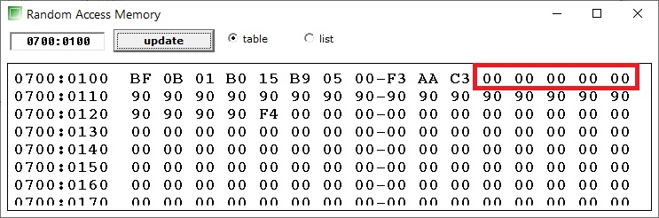
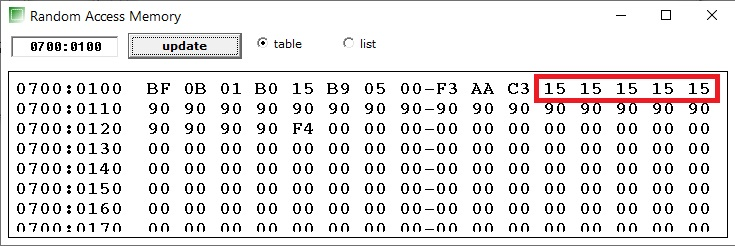

Инструкции процессоров Intel

- [AAA](#aaa)
- [AAD](#aad)
- [AAM](#aam)
- [AAS](#aas)
- [ADC](#adc)
- [ADD](#add)
- [AND](#and)
- [CALL](#call)
- [CBW](#cbw)
- [CLC](#clc)
- [CLD](#cld)
- [CLI](#cli)
- [CMC](#cmc)
- [CMP](#cmp)
- [CMPSB](#cmpsb)
- [CMPSW](#cmpsw)
- [CWD](#cwd)
- [DAA](#daa)
- [DEC](#dec)
- [DIV](#div)
- [HLT](#hlt)
- [JB](#jb)
- [JBE](#jbe)
- [JE](#je)
- [JG](#jg)
- [JGE](#jge)
- [JL](#jl)
- [JMP](#jmp)
- [JNA](#jna)
- [JNB](#jnb)
- [JNL](#jnl)
- [INC](#inc)
- [LEA](#lea)
- [LDS](#lds)
- [LES](#les)
- [LOOP](#loop)
- [MOV](#mov)
- [MUL](#mul)
- [NEG](#neg)
- [NOP](#nop)
- [NOT](#not)
- [OR](#or)
- [OUT](#out)
- [RCL](#rcl)
- [RCR](#rcr)
- [RET](#ret)
- [SBB](#sbb)
- [STC](#stc)
- [STD](#std)
- [STOSB](#stosb)
- [SUB](#sub)
- [TEST](#test)
- [XCHG](#xchg)
- [XLATB](#xlatb)
- [XOR](#xor)
- [Что такое **BCD**](#что-такое-bcd)

## AAA

**Инструкция AAA** (ASCII Adjust After Addition) в Ассемблере делает необходимые поправки в регистрах AH и AL после сложения при работе с BCD-значениями (Binary-Coded Decimal).

У этой команды нет операндов.

Команда AAA работает согласно следующему алгоритму:

Если младшие (правые) четыре бита регистра AL > 9 или флаг AF = 1, то:

```asm
AL = AL + 6
AH = AH + 1
AF = 1
CF = 1
```

иначе

```asm
AF = 0
CF = 0
```

в любом случае команда очищает старшие четыре бита регистра AL.

Флаги AF и CF изменяются в зависимости от результата выполнения команды (см. алгоритм работы выше). Остальные флаги имеют неопределённое состояние и анализировать их нет смысла.

А теперь ещё немного, почти то же самое, что было сказано выше, но другими словами. Возможно, кому то это будет более понятно.

Команда ААА исправляет сумму двух неупакованных двоично-десятичных чисел, которая находится в регистре AL.

Если исправление приводит к десятичному переносу, то значение регистра AH увеличивается на единицу.

Соответственно, перед вызовом команды AAA надо поместить сумму двух неупакованных двоично-десятичных чисел в регистр AL. То есть инструкцию ААА лучше использовать сразу после сложения двух таких чисел.

Например, если при сложении чисел 06 и 09 в регистре АХ окажется число 000Fh, то команда AAA исправит его, и в регистре АХ будет число 0105 (неупакованное десятичное число 15):

```asm
MOV AX, 15   ; AH = 00, AL = 0Fh = 15
AAA          ; AH = 01, AL = 05
```

Команда AAA применяется после выполнения команд ADD или ADC. В итоге сумма, которая находится в регистре AL, всегда будет соответствовать представлению чисел в формате ASCII.

Ниже приведён пример, где показано, как можно сложить два BCD-значения 6 и 9, а с помощью команды AAA получить правильную сумму в BCD-формате (в десятичном упакованном формате).

Обратите внимание, что перед сложением нужно обнулить содержимое регистра AH.

```asm
	.model	tiny
	.code
	ORG 	100h

start:

  MOV   AH, 0           ;Обнулить AH
  MOV   AL, 6           ;AL = 6
  ADD   AL, 9           ;AL = 6 + 9 = 15 = 0Fh
  AAA                 ;Выполнить поправку
  OR    AX, 3030h     ;Преобразовать в коды ASCII

  MOV   DL, AH          ;DL = 31h (ASCII-код числа 1)

  MOV   BX, 676h        ;Позиция первого символа на экране
  MOV   CX, 0B800h      ;Установить CX = B800h (память VGA)
  MOV   DS, CX          ;Копировать значение из CX в DS
  MOV   DH, 01001110b   ;DH = атрибуты цвета
  MOV   [BX], DX        ;Записать символ в видеопамять
  MOV   DL, AL          ;AL = 35h (ASCII-код числа 5)
  ADD   BX, 2           ;Сместить позицию на экране
  MOV   [BX], DX        ;Записать символ в видеопамять

END     start
```

Способ вывода на экран с помощью команды MOV мы уже рассматривали здесь и здесь. Остальное, думаю, понятно из описания.

С помощью команды OR AX, 3030h мы преобразуем содержимое регистров AH и AL в ASCII-коды символов, которые соответствуют находящимся в этих регистрах числам в BCD-формате. В итоге получаем в AX число 3135h (31h - ASCII-код символа 1, а 35h - ASCII-код символа 5).

----------

## AAD

**Инструкция AAD** (ASCII Adjust before Division) в Ассемблере подготавливает два BCD-значения для деления. У этой команды нет операндов.

Команда AAD работает согласно следующему алгоритму:

```asm
AL = AH * 10 + AL
AH = 0
```

Флаги ZF, SF и PF изменяются в зависимости от результата выполнения команды. Остальные флаги имеют неопределённое состояние.

Команда AAD преобразует неупакованное двоично-десятичное число, которое находится в регистре АХ. Делается это таким образом, чтобы последующее деление привело к десятичному результату.

Команда AAD может использоваться с любой системой счисления. Машинный код этой команды D5h 0Ah. В этом коде второй байт можно заменить на другое число.

Действие инструкции AAD заключается в том (см. алгоритм выше), что содержимое регистра АН умножается на второй байт команды (по умолчанию это 0Ah) и складывается с содержимым регистра AL. После этого регистр АН обнуляется. Команду AAD можно также использовать для быстрого умножения на число с записью результата в AL.

Пример программы:

```asm
  .model  tiny
  .code
  ORG     100h

start:

  MOV   AX, 0307h       ;Делимое в BCD-формате
  AAD                   ;AX = 0025h = 37
  MOV   BL, 5           ;Делитель
  DIV   BL              ;AX = 0207h
  ;37 / 5 = 7 (с остатком 2 в регистре АН)

  RET

  END   start
```

Здесь мы помещаем в регистр АХ число 37 в BCD-формате. Затем с помощью команды AAD преобразуем его в десятичное число. Далее делим его на 5 и получаем 7 в регистре AL и 2 в регистре АН (остаток от деления).

А теперь об умножении с помощью команды AAD. Для того, чтобы умножить содержимое регистра АН не на 10, как это делается по умолчанию, а на другое число, нам надо перед этим записать в то место памяти, где расположен второй байт команды AAD, другое значение.

Для этого надо знать адрес этого байта. Программа начинается с адреса DS:100h (значение 100h определено в начале программы директивой ORG). Зная количество команд в программе перед командой AAD и сколько какая команда занимает места в памяти, мы можем вычислить этот адрес. Ну а если говорить об эмуляторе Emu8086, то мы просто можем посмотреть этот адрес в окне отображения памяти (см. видео выше).

А код будет примерно таким:

```asm
MOV [BYTE PTR DS:0113h], 2  ;Множитель
MOV AX, 0300h               ;AH - умножаемое число
AAD                         ;Теперь AL = 6
```

Здесь красным выделен адрес второго байта команды AAD. В вашем случае этот адрес, разумеется, может быть другим.

----------

## AAM

**Инструкция AAM** (ASCII Adjust After Multiplication) в Ассемблере исправляет BCD-значение после умножения.

Синтаксис:

AAM

Команда AAM не имеет операндов.

Флаги ZF, SF, PF могут быть изменены в зависимости от итога выполнения команды. Остальные флаги имеют неопределённое состояние.

Инструкция AAM обычно используется после команды MUL и выполняет следующие действия:

AH = AL / 10 (в регистр АН записывается итог деления значения в AL на число 10).
AL = остаток от деления.
Машинный код команды AAM - D4h 0Ah. Где 0Ah - это основание системы счисления, по отношению к которой выполняется коррекция. Этот байт можно заменить на любое другое число (кроме нуля, как это сделать - можно посмотреть здесь). По умолчанию в этом байте значение 10, но в случае замены на другое число инструкция AAM преобразует значение АХ в две неупакованные цифры любой системы счисления.

Это работает на всех процессорах Интел (начиная с 8086), но появляется в документации только с процессора Пентиум.

По сути действие, которое выполняет команда ААМ - это целочисленное деление значения AL на число, которое находится во втором байте команды (по умолчанию это число равно 0Ah). После деления частное (итог деления) помещается в AH, а остаток - в AL. Поэтому команду ААМ часто используют для быстрого деления в алгоритмах с высокой степенью оптимизации.

Пример программы, где используется инструкция AAM, приведён ниже:

```asm
  .model  tiny
  .code
  ORG     100h

start:

  MOV   AL, 05h   ;Число 1
  MOV   BL, 07h   ;Число 2
  MUL   BL        ;AX = AL * BL = 35 = 0023h

  AAM           ;Теперь AX = 0305h

  RET

  END   start
```

----------

## AAS

**Инструкция AAS** (ASCII Adjust After Subtraction) в Ассемблере исправляет BCD-значение после вычитания.

Синтаксис:

AAS

Команда AAS не имеет операндов.

Флаги CF, AF могут быть изменены в зависимости от итога выполнения команды. Остальные флаги имеют неопределённое состояние.

Алгоритм работы команды AAS:

Если младшие четыре бита регистра AL > 9 или флаг AF = 1, то

```text
AL = AL - 6
AH = AH - 1
AF = 1
CF = 1
```

Иначе

```text
AF = 0
CF = 0
```

В любом случае очистить старшие четыре бита регистра AL
Команда AAS используется после выполнения команд SUB и SBB, с помощью которых одно неупакованное десятичное число вычитается из второго числа, а результат операции помещается в регистр AL.

Команда AAS исправляет итог вычитания таким образом, что значение в регистре AL всегда будет соответствовать представлению чисел в формате ASCII (и BCD).

Исправление разности с помощью инструкции AAS требуется только в том случае, когда результатом является отрицательное число. Ниже в примере мы из числа 1 вычитаем число 7, а затем выполняем ASCII-коррекцию с помощью команды AAS.

```asm
  .model  tiny
  .code
  ORG     100h

start:

  MOV   AH, 0
  MOV   AL, 1
  SUB   AL, 7  ;AH = 00, AL = FA = (1-7)
  AAS        ;AH = FF, AL = 04 = (1-7)+10

  RET

  END   start
```

После выполнения команды SUB в регистре AX находится значение 00FAh. поскольку в регистре AL находится отрицательное значение (1-7 = -6 = FAh).

Так как FAh > 9 (знак при сравнении в данном случае не учитывается), то при выполнении команды AAS было выполнено вычитание числа 6 из регистра AL, вычитание числа 1 из регистра АН, и установлены флаги переноса CF и полупереноса AF.

В итоге в регистре АН получилось довольно странное число: FF04h, которое вроде как должно быть равным -6. Давайте подумаем, как образовалось это значение.

Из регистра АН, который был равен 0, мы вычли 1. То есть число FF в регистре АН вполне объяснимо. А вот с регистром AL будет более запутано.

Итак, после выполнения команды SUB там находится число -6 (FAh). Команда AAS в данном случае должна отнять от этого значения число 6, то есть:

-6 - 6 = -12 = F4h

Но команда AAS в любом случае обнуляет старшие четыре бита регистра AL, поэтому у нас в этом регистре число 04, а в регистре АХ, соответственно, число FF04h.

То есть результат (-6) дополняется до десяти (-6+10 = 4).

Ну или если так будет понятнее, то (без учёта старших четырёх битов регистра AL):

10 - 6 = 4 или Ah - 6 = 4

Да, немного странно. Но если вам надо будет использовать дальше этот результат, например, вывести полученное число на дисплей, то можно поступить, например, так:

```asm
MOV BL, 10 SUB BL, AL ;BL = 6
```

----------

## ADC

**Инструкция ADC** (ADd with Carry) в Ассемблере выполняет сложение с переносом.

Синтаксис:

ADC ЧИСЛО1, ЧИСЛО2

Флаги изменяются в зависимости от итога выполнения команды.

Алгоритм работы команды ADC:

ЧИСЛО1 = ЧИСЛО1 + ЧИСЛО2 + CF

ЧИСЛО1 может быть одно из следующих:

- Область памяти (MEM)
- Регистр общего назначения (REG)

ЧИСЛО2 может быть одно из следующих:

- Область памяти (MEM)
- Регистр общего назначения (REG)
- Непосредственное значение - число (IMM)

С учётом ограничений, которые были описаны выше, комбинации ЧИСЛО1-ЧИСЛО2 могут быть следующими:

```text
REG,    MEM
MEM,    REG
REG,    REG
MEM,    IMM
REG,    IMM
```

Пара команд ADD и ADC применяется для сложения повышенной точности. Также, как и в случае с командой SBB, использование инструкции ADC позволяет складывать, например, 32-разрядные числа с помощью 16-разрядных регистров. Да и вообще разрядность чисел, можно сказать, может быть любой.

Лучше всего это показать на примере:

```asm
	.model	tiny
	.code
	ORG 	100h

start:

    MOV     DX, 0       ;В паре DX:AX (0000:FFFF)
    MOV     AX, 0FFFFh  ;32-разрядное число 65535
    MOV     BX, 0       ;В паре BX:CX
    MOV     CX, 1       ;32-разрядное число 1
    ;65535 + 1 = 65536, то есть после сложения
    ;DX:AX = 65536 (0001:0000)
    ADD     AX, CX      ;AX = 0000
    ADC     DX, BX      ;DX = 0001

    RET

    END     start
```

В комментариях всё достаточно подробно описано. Поэтому добавлять ничего не буду. Если нужны подробности, то см. похожую программу в примере к инструкции SBB.

----------

## ADD

**Команда ADD** (ADDITION - сложить)

Синтаксис команды ADD:

ADD СУММА, ЧИСЛО

С помощью этой команды можно сложить два числа: СУММА и ЧИСЛО складываются, а результат помещается в СУММУ.

Эта команда может изменять флаги (в зависимости от результата - но об этом чуть позже).

ЧИСЛОМ может быть один из следующих:

- Область памяти (MEM)
- Регистр общего назначения (REG)
- Непосредственное значение (например, число) (IMM)

СУММОЙ может быть один из следующих:

- Область памяти (MEM)
- Регистр общего назначения (REG)

То есть эта команда не работает с сегментными регистрами. Комбинации СУММА-ЧИСЛО могут быть следующими:

```text
REG,  MEM
MEM,  REG
REG,  REG
MEM,  IMM
REG,  IMM
```

Пример использования инструкции ADD:

```asm
MOV AL, 5   ; AL = 5
ADD AL, -3  ; AL = 2
```

А теперь о флагах.

Команда ADD в зависимости от результата выполнения может изменять все основные флаги, а именно:

- CF - флаг переноса. Этот флаг может быть изменён, например, при переполнении.
- ZF - флаг нуля. Этот флаг будет установлен, если результатом сложения будет ноль
- SF - флаг знака. Этот флаг будет установлен, если результатом сложения будет отрицательное число.
- OF - флаг переполнения. Этот флаг будет установлен в случае переполнения (то есть когда результат не помещается в СУММУ - значение слишком большое).
- PF - флаг чётности. Этот флаг устанавливается в довольно сложных случаях (для начинающих это пока лишнее), поэтому подробно рассказывать не буду.
- AF - вспомогательный флаг переноса. Для новичков это тоже лишнее.

----------

## AND

**Инструкция AND** выполняет логическое И между всеми битами двух операндов. Результат записывается в первый операнд.

Синтаксис:

AND ЧИСЛО1, ЧИСЛО2

ЧИСЛО1 может быть одним из следующих:

- Область памяти (MEM)
- Регистр общего назначения (REG)

ЧИСЛО2 может быть одним из следующих:

- Область памяти (MEM)
- Регистр общего назначения (REG)
- Непосредственное значение (IMM)

С учётом ограничений, которые были описаны выше, комбинации

ЧИСЛО1-ЧИСЛО2 могут быть следующими:

```text
REG,    MEM
MEM,    REG
REG,    REG
MEM,    IMM
REG,    IMM
```

Как было сказано, команда AND выполняет операцию логического И между всеми битами двух чисел. Таблица истинности для операции логического И выглядит следующим образом:

```text
0	И	0	=	0
0	И	1	=	0
1	И	0	=	0
1	И	1	=	1
```

Почему это называется таблицей истинности? Потому что она отображает результаты выполнения функции с разными параметрами. И эти результаты могут принимать только одно из двух значений: ИСТИНА (логическая 1) или ЛОЖЬ (логический 0).

Логическое И - это операция логического умножения. Чтобы легче было запомнить таблицу истинности для логического И, вспомните математику:

```text
0 * 0 = 0
0 * 1 = 0
1 * 0 = 0
1 * 1 = 1
```

**Что такое битовая маска**

Для чего используются логические операции, такие как логическое умножение? И зачем в ассемблере команды, такие как AND?

Дело в том, что довольно часто приходится сравнивать какое-то число с так называемой битовой маской. И в зависимости от результата выполнять какие-то действия.

Иными словами, довольно часто бывает так, что надо узнать состояние отдельного бита (или нескольких битов) в числе.

Например, нерационально тратить целый байт, чтобы хранить там какое-то логическое значение (например, сигнал на каком-то входе процессора). Поэтому в таких случаях обычно упаковывают в байт 8 логических сигналов, где каждому отдельному биту соответствует какое-то логическое значение.

Давайте представим, что у нас есть какое-то устройство с 8 входами. И сигналы с этих входов каким-то образом упаковываются в один байт, где каждому биту соответствует отдельный вход (с 0 до 7).

А теперь вопрос - как нам узнать, есть сигнал на входе 3 или нет? То есть установлен третий бит в 1, или сброшен в 0?

А вот для этого-то и существуют битовые маски.

Если нам надо, например, узнать состояние третьего входа (отсчёт с нуля, справа налево), то битовая маска для проверки состояния 3-го бита будет такой:

```text
00001000
```

C помощью логических операций можно сравнивать число с этой битовой маской и получать результат.

Делается это просто - если после выполнения операции логического И результат будет нулевым, то интересующий нас бит сброшен (то есть равен 0). Если же результат будет НЕ нулевым (равным маске), то бит установлен (равен 1).

Пример: сравнить число 150 (10010110 в двоичной системе) с битовой маской. В числе 150 третий бит сброшен. Итак (вверху расположен 7-й бит):

```text
Число    Маска
1     И  0     = 0
0     И  0     = 0
0     И  0     = 0
1     И  0     = 0
0     И  1     = 0
1     И  0     = 0
1     И  0     = 0
0     И  0     = 0
```

Результат равен 0, значит, что бит 3 сброшен, то есть также равен 0.

А теперь с числом 159 (10011111)

```text
Число    Маска
1     И  0     = 0
0     И  0     = 0
0     И  0     = 0
1     И  0     = 0
1     И  1     = 1
1     И  0     = 0
1     И  0     = 0
1     И  0     = 0
```

Результат НЕ равен 0, значит, что бит 3 установлен, то есть равен 1.

После выполнения команды AND можно, например, выполнить уже известную нам команду CMP, а затем с помощью какой-либо из инструкций условного перехода направить выполнение программы по нужному нам руслу.

К примеру, если вы создаёте программу для микроконтроллера, то вы можете прочитать состояние портов ввода, а для дальнейшей обработки упаковать их в байт (дальнейшая обработка может понадобиться в тех случаях, например, когда работа устройства зависит от комбинации состояний на входах).

Затем вы сравниваете байт с битовой маской, и в зависимости от результата предпринимаете необходимые действия.

Инструкция AND может применяться и для других целей. Например, вот этот код:

```asm
MOV AL, 'a'        ; AL = 01100001b
AND AL, 11011111b  ; AL = 01000001b  ('A')
```

преобразует маленькую букву а в большую.

Пример использования инструкции AND:

```asm
.model  tiny
.code
ORG     100h

start:

MOV AX, 0B800h    ; установить AX = B800h (память VGA).
MOV DS, AX        ; копировать значение из AX в DS.
MOV CL, 'a'       ; CL = 61h (ASCII-код символа 'a').
MOV CH, 01001110b ; CH = атрибуты цвета (желтый текст на красном фоне).
MOV BX, 72eh      ; BX = позиция на экране = 2*(x + y*80) = (39, 11).
MOV [BX], CX      ; [0B800h:015Eh] = CX (записать символ в видеопамять).
AND CL, 01000001b ; Теперь CL = 41h (ASCII-код символа 'A').
MOV BX, 730h      ; BX = позиция на экране = 2*(x + y*80) = (40, 11).
MOV [BX], CX      ; [0B800h:015Eh] = CX (записать символ в видеопамять).

END     start
```

Как работает инструкция MOV в данном примере, подробно рассказано здесь.

Обычно я привожу расшифровку аббревиатуры инструкции. Однако в данном случае это не требуется, так как AND переводится как И.

----------

## CALL

**Команда CALL** (CALL) в Ассемблере вызывает процедуру.

Синтаксис:

CALL ИМЯ

Здесь ИМЯ может быть одним из следующих:

- Имя процедуры
- Метка
- Переменная
- Регистр
- Адрес (непосредственное значение)

Флаги при выполнении команды CALL не изменяются.

Инструкция CALL выполняет следующие действия:

- Передаёт управление процедуре.
- Записывает в стек адрес следующей команды (из регистра IP в 16-разрядном режиме или EIP - в 32-разрядном).

В случае дальнего вызова регистр CS также записывается в стек.

Если вместо имени процедуры используется адрес, то он может быть записан в формате СЕГМЕНТ:СМЕЩЕНИЕ. Если в качестве адреса указать только смещение, то считается, что адрес расположен в том же сегменте, что и команда CALL (при этом выполняется ближний вызов процедуры).

Команда CALL передаёт управление по адресу, который передаётся в команду в качестве параметра. При этом процессор начинает выполнять команду, расположенную по этому адресу.

Если операндом команды CALL является регистр или переменная, то её значение рассматривается как абсолютное смещение.

Если операнд - это ближняя метка в программе, то ассемблер указывает её относительное смещение.

----------

## CBW

**Инструкция CBW** (Convert Byte to Word) в Ассемблере выполняет преобразование байта в слово.

Синтаксис:

CBW

Эта команда не имеет операндов. Флаги не изменяются.

Чтобы преобразовать байт в слово, инструкция CBW использует следующий алгоритм:

Если старший бит регистра AL равен 1, то записать в регистр AH

- число 255 (0FFh),
- иначе записать в АН число 0.

**Преобразование байта в слово**

Для положительных чисел, пожалуй, в этом смысла нет. Однако для чисел со знаком это может быть полезно. Команда CBW расширяет длину целого числа со знаком, то есть из байта делает слово. При этом знаковый разряд из регистра AL переносится в регистр AH, байт (AL) превращается в слово (АХ), а знак числа сохраняется (см. алгоритм выше).

На пример: Допустим, есть число 5, которое записано в регистр AL (байт). Тогда, чтобы преобразовать байт в слово достаточно просто поместить в регистр AH число 0.

Но если мы  число отрицательное, то: Например, число -5 в регистр AL. Тогда в этом регистре будет шестнадцатеричное число FB. Если просто поместить в регистр AH число 0, то получим слово:

00FB

и это будет число 251 в десятичной системе, а не -5. Потому что число (слово) -5 в шестнадцатеричной системе - это

FFFB

Поэтому, если требуется быстро преобразовать отрицательное число размером с байт в отрицательное число размером со слово, то лучше использовать инструкцию CBW. Эта инструкция обычно используется совместно с командами деления.

Машинный код команды CBW - 98h.

Пример:

```asm
	.model	tiny
	.code
	ORG 	100h

start:

  MOV AH, 0
  MOV AL, -5    ;AL = -5, AX = 00FB = 251
  CBW           ;AX = FFFB = -5

  RET

  END   start
```

----------

## CLC

**Команда CLC** (**CL**ear **C**F) в Ассемблере - это команда сброса флага CF, которая выполняет сброс флага переноса.

Синтаксис:

CLC

После выполнения этой команды флаг CF сбрасывается (очищается, то есть будет равен 0). Остальные флаги не изменяются.

----------

## CLD

**Команда CLD** (**CL**ear **D**F) в Ассемблере очищает флаг направления (DF).

Синтаксис:

CLD

У команды нет операндов. После выполнения команды флаг DF сбрасывается в ноль. Значения остальных флагов не изменяются.

Флаг DF управляет поведением команд обработки строк (такими как CMPSB, CMPSW, LODSB, LODSW, MOVSB, MOVSW, STOSB, STOSW). При использовании этих команд для копирования строк значения регистров SI и DI автоматически увеличиваются или уменьшаются, в зависимости от состояния флага DF. Если этот флаг установлен в 1, то строки обрабатываются в сторону уменьшения адресов, если сброшен в 0, то наоборот.

----------

## CLI

**Команда CLI** (CLear IF) в Ассемблере сбрасывает флаг прерывания (флаг IF).

Синтаксис:

CLI

Выполнение этой команды отключает аппаратные прерывания. Команда не имеет операндов.

После выполнения команды другие флаги не изменяются.

----------

## CMC

**Команда CMC** в Ассемблере переключает флаг переноса (то есть инвертирует значение флага CF).

Синтаксис:

CMC

Эта команда не имеет операндов.

При выполнении команды никакие флаги не изменяются (кроме CF).

----------

## CMP

**Команда CMP** (**C**O**MP**ARE) процессоров семейства i80x86 используется для сравнения двух операндов. Говоря проще, эта команда сравнивает два числа, то есть проверяет, равны эти два числа или НЕ равны.

Синтаксис команды CMP:

CMP ЧИСЛО1, ЧИСЛО2

ЧИСЛО1 может быть одним из следующих:

- Область памяти (MEM)
- Регистр общего назначения (REG)

ЧИСЛО2 может быть одним из следующих:

- Область памяти (MEM)
- Регистр общего назначения (REG)
- Непосредственное значение (например, число) (IMM)

Таким образом, комбинации ЧИСЛО1-ЧИСЛО2 могут быть следующими:

```text
REG, MEM
MEM, REG
REG, REG
MEM, IMM
REG, IMM
```

**Сравнение чисел в Ассемблере**

Сравнение чисел в Ассемблере с помощью инструкции CMP выполняется по следующему алгоритму:

- Из ЧИСЛА1 вычитается ЧИСЛО2 (ЧИСЛО1 - ЧИСЛО2)
- Если результат равен нулю, то ЧИСЛО1 = ЧИСЛО2
  Если числа равны, то есть результат равен 0, то устанавливается флаг ZF
- Остальные флаги также устанавливаются или сбрасываются в зависимости от результата.

Но нас больше всего интересует флаг ZF.

Итак, чтобы сравнить два числа в Ассемблере нам надо выполнить следующие действия:

Выполнить команду CPM
Прочитать флаг ZF
Если ZF = 1, то числа равны
Если ZF = 0, то числа НЕ равны
Ну а дальше, в зависимости от результата, мы можем выполнить переход на какую-то метку в программе. В статье об использовании инструкции JMP я рассказывал о метках и о безусловном переходе.

Для того, чтобы выполнить переход после сравнения чисел, требуется использовать одну из команд условного перехода. Но об этих команда будет рассказано в соответствующих статьях.

Пример участка программы сравнения чисел на Ассемблере приведён ниже:

MOV AL, 5      ; AL = 5
MOV AH, 5      ; AH = 5
CMP AL, AH     ; AL = AH, ZF = 1

CMP AL, 6      ; AL <> 6, ZF = 0
Здесь мы сначала помещаем в регистры AL и AH два одинаковых числа (5), а затем выполняем команду CMP - сравниваем значения в регистрах AL и AH.

Так как эти значения равны, то после выполнения команды CMP флаг ZF будет установлен, то есть равен 1.

Затем мы сравниваем содержимое регистра AL с число 6. Так как в регистре AL у нас осталось число 5, то после выполнения команды CMP флаг ZF будет сброшен (то есть равен 0), так как сравниваемые значения НЕ равны.

----------

## CMPSB

**Команда CMPSB** (**C**o**MP**are a **S**et of **B**ytes - сравнить набор байтов) в Ассемблере выполняет сравнение последовательности байтов из участка памяти, адрес которого указан в регистре ESI с другим участком, адрес которого указан в регистре DSI. Синтаксис:

`CMPSB`

Команда не имеет операндов. В зависимости от результата могут изменяться флаги OF, SF, ZF, AF, PF, CF.
Алгоритм выполнения команды CMPSB:

DS:[SI] - ES:[DI]
Установить флаги OF, SF, ZF, AF, PF, CF в соответствии с результатом

Если DF = 0 то:

```text
SI = SI + 1
DI = DI + 1
```

Иначе:

```text
SI = SI - 1
DI = DI - 1
```

Подробнее про флаг DF можете почитать [здесь](#STD).

То есть с помощью команды REPE команда CMPSB выполняется до тех пор, пока флаг ZF равен 1. Однако команда вызывается не более, чем указано в СХ (а в этом регистре указана длина массива данных - количество байтов для сравнения).

То есть выполняется последовательное сравнение двух массивов данных побайтно. И если какая-то пара байтов в последовательности отличается, то флаг ZF будет сброшен в 0 и вызов команды CMPSB прекратится, даже если ещё не весь массив данных проверен. Таким образом выполняется поверка байтов на равенство до первого несовпадения.

Это также позволяет определить номер байта в массиве, где обнаружено несовпадение (этот номер будет в счётчике СХ после завершения сравнения, отсчёт начинается с нуля).

С помощью команды CMPSB в Ассемблере можно сравнивать, например, строки, как это показано в примере:

```asm
  .model  tiny
  .code
  ORG   100h

;Сбросить флаг направления
  CLD

;Загрузить источник (source) в DS:SI
;Загрузить цель (target) в ES:DI
  MOV  AX,  CS
  MOV  DS,  AX
  MOV  ES,  AX
  LEA  SI,  str1
  LEA  DI,  str2

;Установить счётчик для размера данных в словах
  MOV  CX,  size

;Сравнивать, пока равно
  REPE CMPSB
  JNZ  NotEqual

;"yes" - равно
  MOV  AL,  'y'
  MOV  AH,  0Eh
  INT  10h

  JMP  ExitHere

NotEqual:

;"no" - не равно
  MOV  AL, 'n'
  MOV  AH, 0Eh
  INT  10h

ExitHere:

;Ждать нажатия клавиши:
  MOV  AH,  0
  INT  16h

  RET

;Массивы данных должны иметь одинаковый размер:
x1:
str1 DB 'Test string'
str2 DB 'Test string'
size = ($ - x1) / 2
```

----------

## CMPSW

**Команда CMPSW**  (**C**o**MP**are a **S**et of **W**ords - сравнить набор слов) в Ассемблере выполняет сравнение последовательности слов из участка памяти, адрес которого указан в регистре ESI, с другим участком, адрес которого указан в регистре DSI. Синтаксис:

`CMPSW`

Команда не имеет операндов. В зависимости от результата могут изменяться флаги OF, SF, ZF, AF, PF, CF.

Алгоритм выполнения команды CMPSW:

DS:[SI] - ES:[DI]

Установить флаги OF, SF, ZF, AF, PF, CF в соответствии с результатом

- Если DF = 0 то:

```text
SI = SI + 2
DI = DI + 2
```

Иначе:

``text
SI = SI - 2
DI = DI - 2
```

Подробнее про флаг DF можете почитать [здесь](#).

То есть с помощью команды REPE команда CMPSW выполняется до тех пор, пока флаг ZF равен 1. Однако команда вызывается не более, чем указано в СХ (а в этом регистре указана длина массива данных - количество слов для сравнения).

То есть выполняется последовательное сравнение двух массивов данных по каждому слову. И если какая-то пара слов в последовательности отличается, то флаг ZF будет сброшен в 0 и вызов команды CMPSW прекратится, даже если ещё не весь массив данных проверен. Таким образом выполняется проверка слов на равенство до первого несовпадения.

Это также позволяет определить номер слова в массиве, где обнаружено несовпадение (этот номер будет в счётчике СХ после завершения сравнения, отсчёт начинается с нуля).

Пример:

```asm
  .model	tiny
  .code
  ORG 	100h

;Сбросить флаг направления
  CLD

;Загрузить источник (source) в DS:SI
;Загрузить цель (target) в ES:DI
  MOV  AX,  CS
  MOV  DS,  AX
  MOV  ES,  AX
  LEA  SI,  data1
  LEA  DI,  data2

;Установить счётчик для размера данных в словах
  MOV  CX,  size

;Сравнивать, пока равно
  REPE CMPSW
  JNZ  NotEqual

;"yes" - равно
  MOV  AL,  'y'
  MOV  AH,  0Eh
  INT  10h

  JMP  ExitHere

NotEqual:

;"no" - не равно
  MOV  AL, 'n'
  MOV  AH, 0Eh
  INT  10h

ExitHere:

;Ждать нажатия клавиши:
  MOV  AH,  0
  INT  16h

  RET

;Массивы данных должны иметь одинаковый размер:

x1:
data1 DW 1234h, 5678h, 9012h, 3456h
data2 DW 1234h, 5678h, 9012h, 3456h
size = ($ - x1) / 4
```

## CWD

**Команда CWD** (**C**onvert **W**ord to **D**oubleword - преобразовать слово в двойное слово) в Ассемблере выполняет преобразование слова в двойное слово. Синтаксис:

`CWD`

Слово, которое находится в [регистре](./README.md#основные-регистры-процессоров-intel) АХ, будет преобразовано в двойное слово и помещено в пару регистров DX (старшее слово) и AX (младшее слово). Значение регистра АХ при этом не изменяется.

Алгоритм:

- Если старший бит АХ равен 1 (число отрицательное), то в DX записать 65535 (FFFF)
- Иначе в DX записать 0

Команда не имеет операндов и никакие флаги при выполнении команды не изменяются.

По сути команда переносит знак числа из старшего разряда слова в старший разряд двойного слова. То есть она имеет смысл только для отрицательных чисел. Обычно используется при работе с большими числами, например, при делении целых чисел.

Пример на ассемблере:

```asm
  .model	tiny
  .code
  ORG 	100h

start:

  MOV  AX,  100
  CWD           ; DX = 0

  MOV  AX,  -100
  CWD           ; DX = 65535 (FFFF)

  RET           ; Выйти из программы

  END start
```

----------

## DAA

**Команда DAA** (**D**ecimal **A**djust after **A**ddition - десятичная коррекция после сложения) в Ассемблере выполняет десятичную коррекцию после сложения. Синтаксис:

`DAA`

Инструкция DAA корректирует результат сложения двух упакованных [BCD-значений](#BCD-значений). В зависимости от результата эта команда может изменять [флаги](#флаги) CF, ZF, SF, OF, PF, AF.

Алгоритм работы команды DAA:

- Если младшие четыре бита (младшая цифра) в регистре AL больше 9 или AF = 1, то:

```text
AL = AL + 6
AF = 1
CF = CF или Перенос последнего сложения
```

- Иначе AF = 0

- Если AL > 9Fh или CF = 1, то:

```text
AL = AL + 60h
CF = 1
```

- Иначе CF = 0

Пример на ассемблере:

```asm
.model tiny
.code
ORG 100h

start:

MOV  AL,  33h   ; AL = 33h
ADD  AL,  49h   ; AL = 33h + 48h
DAA             ; AL = 82h

RET

END start
```

Команда DAA:

Получает двоичное число, которое является результатом выполнения команд ADD или ADC

Преобразует это число в упакованный десятичный формат
В приведенном выше примере складываются два упакованных десятичных числа 33h (51) и 49h (73). В итоге получается число 7Ch (124). Младшая цифра результата Сh, больше, чем 9, поэтому выполняется коррекция результата по описанному выше алгоритму:

К значению регистра AL прибавляем 6 (124 + 6 = 130 = 82h)
Флаг AF устанавливаем в 1
Коррекция старшей цифры не выполняется, так как значение в AL меньше, чем 9F (см. алгоритм выше).

----------

## DEC

**Инструкция DEC** (сокращение от английского слова **DEC**REMENT, которое произошло от латинского слова DECREMENTUM (уменьшение, убыль) в Ассемблере уменьшает число на единицу.

Синтаксис:

`DEC ЧИСЛО`

Состояние [флагов](./README.md#регистр-флагов) зависит от результата выполнения команды. Значение флага CF при этом не изменяется.

ЧИСЛО может быть одним из следующих:

- Область памяти (MEM)
- Регистр общего назначения (REG)

Декремент - это уменьшение числа на какое-то значение (обычно на единицу). Что касается команды DEC, то она уменьшает число именно на единицу. Алгоритм такой:

`ЧИСЛО = ЧИСЛО - 1`

Пример:

```asm
	.model	tiny
	.code
	ORG 	100h

start:

MOV  AL,  10   ;Поместить в AL число 10
DEC  AL        ;Уменьшить AL на единицу

END start
```

----------

## DIV

**Инструкция DIV** (сокращение от английского слова **DIV**IDE, которое можно перевести как “разделить”) в Ассемблере выполняет деление без знака.

Cинтаксис:

`DIV ЧИСЛО`

ЧИСЛОМ может быть один из следующих:

- Область памяти (MEM)
- Регистр общего назначения (REG)

Эта команда не работает с сегментными регистрами, а также не работает непосредственно с числами. То есть вот так

```asm
DIV 200 ; неправильно
```

делать нельзя.

Алгоритм работы команды DIV:

Если ЧИСЛО - это БАЙТ, то AL = AX / ЧИСЛО

Если ЧИСЛО - это СЛОВО, то AX = (DX AX) / ЧИСЛО

Инструкция `DIV` работает либо с регистром АХ, либо с парой регистров DX AX. То есть перед выполнением этой команды нам надо записать в регистр АХ или пару регистров DX AX значение, которое требуется разделить.

Затем надо в область памяти или в регистр общего назначения записать делитель - то есть число, на которое будем делить.

Далее мы выполняем деление, и получаем результат либо в регистр АL (если ЧИСЛО - это байт), либо в регистр AX (если ЧИСЛО - это слово).

Остаток от деления:

Как вы понимаете, инструкция `DIV` выполняет целочисленное деление. При этом остаток от деления, если таковой имеется, будет записан:

- В регистр АН, если ЧИСЛО - это байт
- В регистр DX, если ЧИСЛО - это слово

Никакие флаги при этом не изменяются, следовательно, проверять флаги нет необходимости.

Просто если есть сомнения, что деление выполнено без остатка, надо проверить содержимое регистров AL или DX в зависимости от того, какой размер имеет ЧИСЛО.

*Пример деления в Ассемблере*

Hапример, надо 250 разделить на 150. Тогда:

```asm
MOV AX, 250   ; Делимое в регистр AX
MOV BL, 150   ; Делитель в регистр BL
DIV BL        ; Теперь АL = 250 / 150 = 1, AH = 100
```

>Bнимание, команда DIV не работает непосредственно с числами, а только с регистрами общего назначения или с памятью.

После выполнения этого кода в регистре АL будет результат целочисленного деления числа 250 на число 150, то есть число 1, а в регистре АН будет остаток от деления - число 100 (64 в шестнадцатеричной системе).

Теперь попробуем число 50000000 разделить на 60000.

```asm
MOV DX, 762      ; Старшая часть (в HEX: 02FAh)
MOV AX, 61568   ; Младшая часть (в HEX: F080h)
                ; Вместе DX:AX = 02FAF080h = 50 000 000
MOV BX, 60000   ; Делитель в регистр BX
DIV BX          ; Теперь АХ = 50000000 / 60000 = 833 (341h)
                ; DX = 20000 (4E20h)
```

----------

## HLT

**Команда HLT** (**H**a**LT**, что можно перевести как “остановить”, “прекратить”, “приостановить”) в Ассемблере останавливает работу процессора.

Синтаксис:

`HLT`

Команда не имеет операндов и не изменяет никакие флаги.

Эта инструкция переводит процессор в состояние останова, из которого его может вывести только аппаратное прерывание или перезагрузка. Если причиной было прерывание, то адрес возврата, помещаемый в стек для обработчика прерывания, указывает на следующую после HLT команду.

>ВНИМАНИЕ!
>Команда выполняется ТОЛЬКО в реальном режиме или с CPL = 0. Поскольку CPL = 0 - это уровень привилегий ядра операционной системы, то пользовательские программы в защищённом режиме не могут воспользоваться этой командой.

В эмуляторах эта команда просто выполняет выход из программы. Правда, в отличие от, например, команды RET, при этом будет другое сообщение. Скорее всего что-то типа “эмулятор остановлен”, а не “возврат управления операционной системе”.

Пример:

```asm
  .model tiny
  .code
  ORG    100h

begin:
  MOV  AX,  1
  MOV  AX,  2
  HLT          ; Останавливаем процессор
  ; В АХ не будет записано 3, но если
  ; возврат в рабочий режим будет вызван
  ; прерыванием, то в качестве адреса возврата
  ; в стеке для обработчика прерывания
  ; будет указан
  MOV  AX,  3  ; <- адрес этой команды

  RET

  END  begin
```

Напоследок, как всегда, о происхождении аббревиатуры HLT.

HLT - это сокращение от слова .

----------

## JB

**Инструкция JB** выполняет короткий переход, если первый операнд МЕНЬШЕ второго операнда при выполнении операции сравнения с помощью команды CMP.

Синтаксис команды JB:

`JB МЕТКА`

О метках в команде [JMP](#jmp).

Инструкция JB проверяет флаг CF. Если этот флаг равен 1, то выполняется переход к МЕТКЕ.

Сама же инструкция JB при работе никакие флаги не изменяет.

Условный переход в Ассемблере
В команде [JMP](#jmp) рассказано о безусловном переходе. Условный переход в Ассемблере можно выполнить с помощью нескольких инструкций, в том числе с помощью команды JB.

Условный переход в Ассемблере выполняется примерно по такому алгоритму:

Если УСЛОВИЕ ВЫПОЛНЯЕТСЯ, то перейти к МЕТКЕ
Если УСЛОВИЕ НЕ ВЫПОЛНЯЕТСЯ, то выполнить следующую инструкцию
Если говорить непосредственно об инструкции JB, то условием перехода к метке является CF=1 (то есть когда первый операнд меньше второго), а алгоритм её использования может быть таким:

```text
Сравнить ЧИСЛО1 с ЧИСЛОМ2 с помощью команды CMP
УСЛОВИЕ: ЧИСЛО1 < ЧИСЛА2
Выполнить инструкцию JB
```

Пример использования команды JB:

```asm
	.model	tiny
	.code
	ORG 	100h

start:

  MOV AL, 5      ; AL = 5
  MOV AH, 5      ; AH = 5
  CMP AL, AH     ; AL = AH, ZF = 1
  JB  lblLess
    ;Так как AL = AH, то УСЛОВИЕ ПЕРЕХОДА НЕ ВЫПОЛНЯЕТСЯ
    ;Поэтому будут выполнены следующие инструкции
  MOV AL, 5      ; AL = 5
  MOV AH, 6      ; AH = 6
  CMP AL, AH     ; AL < AH
  JB  lblLess
    ;Так как AL < AH, то УСЛОВИЕ ПЕРЕХОДА ВЫПОЛНЯЕТСЯ
    ;Поэтому следующие инструкции НЕ будут выполнены,
    ;а будет переход сразу к метке lblLess
  MOV AL, 5      ; AL = 5
  MOV AH, 6      ; AH = 6

lblLess:
  MOV AH, 9      ; AH = 9

  END	start
```

----------

## JBE

**Команда JBE** выполняет короткий переход, если первый операнд МЕНЬШЕ или РАВЕН второму операнду при выполнении операции сравнения с помощью команды CMP.

Синтаксис команды JBE:

`JBE МЕТКА`

Инструкция JBE проверяет флаги CF и ZF. Если любой из этих флагов равен 1, то выполняется переход к МЕТКЕ.

Инструкция JBE при работе никакие флаги не изменяет.

Инструкция JBE выполняет переход в любом из двух случаев:

```text
Если первый операнд меньше второго
ИЛИ первый операнд равен второму
```

Напомню также, что команда JBE, также как и команда JB, выполняет в ассемблере условный переход.

Пример использования команды JBE:

```asm
	.model	tiny
	.code
	ORG 	100h

start:

  MOV AL, 6      ; AL = 6
  MOV AH, 5      ; AH = 5
  CMP AL, AH     ; AL > AH, ZF = 0, CF = 0
  JBE  lblJBE
    ;Так как AL > AH, то УСЛОВИЕ ПЕРЕХОДА НЕ ВЫПОЛНЯЕТСЯ
    ;Поэтому будут выполнены следующие инструкции
  MOV AL, 5      ; AL = 5
  MOV AH, 6      ; AH = 6
  CMP AL, AH     ; AL < AH, ZF = 0, CF = 1
  JBE lblJBE
    ;Так как AL < AH, то УСЛОВИЕ ПЕРЕХОДА ВЫПОЛНЯЕТСЯ
    ;Поэтому следующие инструкции НЕ будут выполнены,
    ;а будет переход сразу к метке lblJBE
lblJBE2:
  MOV AH, 9      ; AH = 6

lblJBE:
  MOV AL, AH     ; AL = 6 при первом заходе, ZF = 1
                 ; и 9 - при втором, ZF = 0
  MOV AH, 6      ; AH = 6
  CMP AL, AH     ; AL = AH при первом заходе,
                 ; AL > AH при втором
  JBE lblJBE2

  MOV AH, 15

  END start
```

----------

## JE

**Инструкция JE** выполняет короткий переход, если первый операнд РАВЕН второму операнду при выполнении операции сравнения с помощью команды CMP.

Синтаксис команды JE:

`JE МЕТКА`

Инструкция JE проверяет флаг ZF. Если этот флаг равен 1, то выполняется переход к МЕТКЕ.

Сама же инструкция JE при работе никакие флаги не изменяет.

Инструкция JE входит в список команд условного перехода, которых в ассемблере довольно много - на все случаи жизни.

Пример использования команды JE:

```asm
  .model  tiny
  .code
  ORG   100h

start:

  MOV AL, 5      ; AL = 5
  MOV AH, 5      ; AH = 5
  CMP AL, AH     ; AL = AH, ZF = 1
  JE  lblJE
    ;Так как AL = AH, то УСЛОВИЕ ПЕРЕХОДА ВЫПОЛНЯЕТСЯ,
    ;а следующие инструкции НЕ выполняются,
    ;так как программа переходит к метке lblJE
  MOV AL, 5      ; AL = 5
  MOV AH, 6      ; AH = 6
  CMP AL, AH     ; AL < AH, ZF = 0, CF = 1
  JBE lblJE

lblJE:
  MOV AH, 15

  END start
```

----------

## JG

**Инструкция JG** выполняет короткий переход, если первый операнд БОЛЬШЕ второго операнда при выполнении операции сравнения с помощью команды CMP.

Синтаксис команды JG:

`JG МЕТКА`

Инструкция JG проверяет флаги ZF, SF и OF. Переход выполняется, если

```text
ZF = 0
SF = OF
```

Сама же инструкция JG при работе никакие флаги не изменяет.

Инструкция JG входит в список команд условного перехода, но, в отличие от большинства этих команд, может сравнивать и отрицательные числа.

Пример использования команды JG:

```asm
  .model  tiny
  .code
  ORG   100h

start:

  MOV AL, 0      ; AL = 0
  MOV AH, -5     ; AH = -5
  CMP AL, AH     ; AL > AH, ZF = 0, SF = OF
  JG  lblJG
    ;Так как AL > AH, то УСЛОВИЕ ПЕРЕХОДА ВЫПОЛНЯЕТСЯ,
    ;а следующие инструкции НЕ выполняются,
    ;так как программа переходит к метке lblJG
  MOV AL, 5      ; AL = 5
  MOV AH, 6      ; AH = 6
  CMP AL, AH     ; AL < AH, ZF = 0, CF = 1
  JBE lblJG

lblJG:
  MOV AH, 15

  END	start
```

----------

## JGE

**Команда JGE** выполняет короткий переход, если первый операнд БОЛЬШЕ второго операнда или РАВЕН ему при выполнении операции сравнения с помощью команды CMP.

Синтаксис команды JGE:

`JGE МЕТКА`

Инструкция JGE проверяет флаги SF и OF. Переход выполняется, если SF = OF.

Сама же инструкция JGE при работе никакие флаги не изменяет.

Инструкция JGE входит в список команд условного перехода, но, в отличие от большинства этих команд, может работать и с отрицательными числами.

Пример использования команды JGE:

  .model  tiny
  .code
  ORG   100h

start:

  MOV AL, -5     ; AL = -5
  MOV AH, -5     ; AH = -5
  CMP AL, AH     ; AL = AH, SF = OF
  JGE lblJGE
    ;Так как AL = AH, то УСЛОВИЕ ПЕРЕХОДА ВЫПОЛНЯЕТСЯ,
    ;а следующие инструкции НЕ выполняются,
    ;так как программа переходит к метке lblJGE
  MOV AL, 5      ; AL = 5
  MOV AH, 6      ; AH = 6
  CMP AL, AH     ; AL < AH, ZF = 0, CF = 1
  JBE lblJGE

lblJGE:
  MOV AH, 15

  END start

----------

## JL

**Инструкция JL** выполняет короткий переход, если первый операнд МЕНЬШЕ второго операнда при выполнении операции сравнения с помощью команды CMP.

Синтаксис команды JL:

`JL МЕТКА`

Инструкция JL проверяет флаги SF и OF. Переход выполняется, если SF не равен OF.

Сама же инструкция JL при работе никакие флаги не изменяет.

Инструкция JL входит в список команд условного перехода, но, в отличие от многих из этих команд, может работать и с отрицательными числами.

Пример использования команды JL приведён ниже:

```asm
  .model  tiny
  .code
  ORG   100h

start:

  MOV AL, -5     ; AL = -5
  MOV AH, 0      ; AH = 0
  CMP AL, AH     ; AL = AH, SF <> OF
  JL lblJL
    ;Так как AL < AH, то УСЛОВИЕ ПЕРЕХОДА ВЫПОЛНЯЕТСЯ,
    ;а следующие инструкции НЕ выполняются,
    ;так как программа переходит к метке lblJL
  MOV AL, 5      ; AL = 5
  MOV AH, 6      ; AH = 6
  CMP AL, AH     ; AL < AH, ZF = 0, CF = 1
  JBE lblJL

lblJL:
  MOV AH, 15

  END start

----------

## JLE

**Команда JLE** выполняет короткий переход, если первый операнд МЕНЬШЕ второго операнда или РАВЕН ему при выполнении операции сравнения с помощью команды CMP.

Синтаксис команды JLE:

`JLE МЕТКА`

Инструкция JLE проверяет флаги SF, OF и ZF. Переход выполняется, если

```text
SF не равен OF
или ZF = 1
```

Сама же инструкция JLE при работе никакие флаги не изменяет.

Инструкция JLE входит в список команд условного перехода, но, в отличие от многих из этих команд, может работать и с отрицательными числами.

Если вы помните, то команда JBE делает то же самое, то есть выполняет переход, если первый операнд меньше или равен второму. Однако команда JBE может работать только с положительными числами, в то время как JLE - как с положительными, так и с отрицательными.

Пример использования команды JLE:

```asm
  .model  tiny
  .code
  ORG   100h

start:

  MOV AL, -5      ; AL = -5
  MOV AH, 0       ; AH = 0
  CMP AL, AH      ; AL < AH, ZF = 0, CF = 0
  JBE lblJBE
  ;Так как AL < AH, то УСЛОВИЕ ПЕРЕХОДА ВЫПОЛНЯЕТСЯ
  ;Но команда JBE не работает с отрицательными числами,
  ;поэтому следующие инструкции БУДУТ выполнены,
  ;а перехода к метке lblJBE НЕ будет
  MOV AH, 20

lblJBE:
  MOV AL, -5      ; AL = -5
  MOV AH, 0       ; AH = 6
  CMP AL, AH      ; AL < AH, ZF = 0, CF = 1
  JLE lblJLE
    ;Так как AL < AH, то УСЛОВИЕ ПЕРЕХОДА ВЫПОЛНЯЕТСЯ
    ;Поэтому следующие инструкции НЕ будут выполнены,
    ;а будет переход сразу к метке lblJLE
  MOV AH, 20

lblJLE:
  MOV AH, 15

  END start
```

----------

## JMP

**Команда JMP** - это команда *безусловного* перехода в Ассемблере. Выполняет, соответственно, безусловный переход в указанное место.

Синтаксис команды JMP:

`JMP МЕТКА`

`МЕТКОЙ` может быть один из следующих:

- Идентификатор метки в исходном коде
- Адрес в формате СЕГМЕНТ:СМЕЩЕНИЕ

*Безусловный переход* в Ассемблере выполняется всегда и в любом случае, если в исходном коде имеется инструкция JMP.

Никакие флаги при выполнении этой инструкции не изменяются.

**Безусловный переход**:

Как следует из названия, это переход без условий. Это значит, что если в исходном коде встречается команда JMP, то эта команда выполняет переход на указанный в МЕТКЕ адрес без каких либо условий - в любом случае.

**Метка в Ассемблере**

Метка - это идентификатор, после которого следует двоеточие. Идентификатор должен быть составлен по правилам составления идентификаторов для конкретного языка программирования

----------

## JNA

**Инструкция JNA** (**J**ump if **N**ot **A**bove) в Ассемблере выполняет короткий переход, если первый операнд НЕ больше второго (то есть меньше или равен второму) при выполнении команды CMP.

Синтаксис:

`JNA МЕТКА`

Алгоритм работы команды:

Если CF = 1 или ZF = 1, то выполнить переход к МЕТКЕ.

Команда работает с числами БЕЗ знака (то есть только с неотрицательными числами).

```asm
Пример:

  .model  tiny
  .code
  ORG   100h

start:

  MOV AL, 5      ; AL = 5
  MOV AH, 5      ; AH = 5
  CMP AL, AH     ; AL = AH, SF = OF
  JNA lblJNA
    ;Так как AL = AH, то УСЛОВИЕ ПЕРЕХОДА ВЫПОЛНЯЕТСЯ,
    ;а следующие инструкции НЕ выполняются,
    ;так как программа переходит к метке lblJNA
  MOV AL, 100    ; AL = 5

lblJNA:
  MOV AH, 15

  RET

  END start
```

----------

## JNB

**Инструкция JNB** (**J**ump if **N**ot **B**elow) в Ассемблере выполняет короткий переход, если первый операнд НЕ меньше второго (то есть больше или равен второму) при выполнении команды CMP.

Синтаксис:

`JNB МЕТКА`

После выполнения этой команды флаги не изменяются.

Алгоритм работы команды:

Если CF = 0 или ZF=1, то выполнить переход к МЕТКЕ.

Команда работает с числами БЕЗ знака (то есть только с неотрицательными числами).

Пример:

```asm
  .model  tiny
  .code
  ORG   100h

start:

  MOV AL, 5      ; AL = 5
  MOV AH, 5      ; AH = 5
  CMP AL, AH     ; AL = AH, ZF = 1
  JNB lbl_1
    ;Так как AL = AH, то УСЛОВИЕ ПЕРЕХОДА ВЫПОЛНЯЕТСЯ,
    ;а следующие инструкции НЕ выполняются,
    ;так как программа переходит к метке lbl_1
  MOV AL, 100    ; AL = 5

lbl_1:
  MOV AH, 15

  CMP AH, AL     ; AH > AL, CF = 0
  JNB lbl_2
    ;Так как AH > AL, то УСЛОВИЕ ПЕРЕХОДА ВЫПОЛНЯЕТСЯ,
    ;а следующие инструкции НЕ выполняются,
    ;так как программа переходит к метке lbl_2
    MOV AL, 100    ; AL = 5

lbl_2:
  MOV AH, 0

  RET

  END start
```

----------

## JNL

**Инструкция JNL** (**J**ump if **N**ot **L**ess) в Ассемблере выполняет короткий переход, если первый операнд НЕ меньше второго (то есть больше или равен второму) при выполнении команды CMP. Синтаксис:

`JNL МЕТКА`

Флаги не изменяются.

Алгоритм работы команды:

Если SF = OF, то выполнить переход к МЕТКЕ.

Команда работает с числами со знаком (то есть как с положительными, так и отрицательными числами).

Пример:

```asm
  .model  tiny
  .code
  ORG   100h

start:

  MOV AL, 5      ; AL = 5
  MOV AH, 5      ; AH = 5
  CMP AL, AH     ; AL = AH, SF = OF
  JNL lblJNL
    ;Так как AL = AH, то УСЛОВИЕ ПЕРЕХОДА ВЫПОЛНЯЕТСЯ,
    ;а следующие инструкции НЕ выполняются,
    ;так как программа переходит к метке lblJNA
  MOV AL, 100    ; AL = 5

lblJNL:
  MOV AH, 15

  RET

  END start
  ```

----------

## INC

**Команда INC** (латинского слова **INC**REMENTUM (приращение, прибыль)) в Ассемблере увеличивает число на единицу.

Синтаксис:

`INC ЧИСЛО`

Состояние флагов зависит от результата выполнения команды. Значение флага CF при этом не изменяется. В этом и заключается основное отличие инструкции INC от вызова команды ADD ЧИСЛО, 1 (в этом случае флаг CF может быть изменён).

ЧИСЛО может быть одним из следующих:

- Область памяти (MEM)
- Регистр общего назначения (REG)

Что такое инкремент

Инкремент - это увеличение числа на какое-то значение (обычно на единицу). Что касается команды INC, то она увеличивает число именно на единицу. Алгоритм такой:

`ЧИСЛО = ЧИСЛО + 1`

В языках высокого уровня существуют процедуры, которые могут выполнять уменьшение не только на единицу, но и на другое заданное число.

Пример:

```asm
  .model  tiny
  .code
  ORG   100h

start:

MOV  AL,  1    ;Поместить в AL число 1
INC  AL        ;Увеличить AL на единицу

END start
```

----------

## LEA

**Команда LEA** (**L**oad **E**ffective **A**ddress) в Ассемблере вычисляет эффективный адрес ИСТОЧНИКА и помещает его в ПРИЁМНИК.

Синтаксис:

`LEA ПРИЁМНИК, ИСТОЧНИК`

После выполнения этой команды флаги не изменяются.

>**Обратите внимание**, что

- ИСТОЧНИКОМ может быть только переменная (ячейка памяти)
- ПРИЁМНИКОМ - только регистр (но не сегментный).

**Эффективный адрес** это

“Эффективный” можно перевести на русский как “действенный”, “действующий”, “настоящий”.

Что касается программистской терминологии, то в некоторых источниках вместо “эффективный адрес” встречается словосочетание “текущий адрес” или даже “виртуальный адрес”.

Ну а если кратко, то эффективный (текущий) адрес - это

`БАЗА + СМЕЩЕНИЕ + ИНДЕКС`

где БАЗА - это базовый адрес, находящийся в регистре (при 16-разрядной адресации могут использоваться только регистры BX или BP); СМЕЩЕНИЕ (или ОТКЛОНЕНИЕ - displacement) - это константа (число со знаком), заданная в команде; ИНДЕКС - значение индексного регистра (при 16-разрядной адресации могут использоваться только регистры SI или DI).

Любая из частей эффективного адреса может отсутствовать (например, необязательно указывать СМЕЩЕНИЕ или ИНДЕКС), но обязательно должна присутствовать хотя бы одна часть (например, только БАЗА).

Вычисление эффективного адреса:

Команда LEA выполняет вычисление адреса и в итоге в ПРИЁМНИК записывается адрес памяти (точнее, только смещение).

С помощью команды LEA можно вычислить адрес переменной, которая описана сложным способом адресации (например, по базе с индексированием, что часто используется при работе с массивами и строками).

Если адрес 32-разрядный, а ПРИЁМНИК - 16-разрядный, то старшая половина вычисленного адреса теряется. Если наоборот, ПРИЁМНИК - 32-разрядный, а адрес 16-разрядный, то вычисленное смещение дополняется нулями.

Команда LEA позволяет определить текущее смещение косвенного операнда любого типа. Так как при косвенной адресации может использоваться один или два регистра общего назначения, то приходится каким-то образом вычислять текущее смещение операнда во время выполнения программы.

Команду LEA также удобно применять для определения адреса параметра, находящегося в стеке. Например, если в процедуре определяется локальный массив, то для работы с ним часто необходимо загрузить его смещение в индексный регистр (что как раз таки можно сделать командой LEA).

Оператор `OFFSET` позволяет определить смещение только при компиляции, и в отличие от него команда LEA может сделать это во время выполнения программы. Хотя в остальных случаях обычно вместо LEA используют MOV и OFFSET, то есть

`LEA ПРИЁМНИК, ИСТОЧНИК`

это то же самое, что и

`MOV ПРИЁМНИК, offset ИСТОЧНИК`

При этом следует помнить об указанных выше ограничениях применения оператора OFFSET.

Пример программы:

```asm
  .model  tiny
  .code
  ORG 100h

start:
  LEA  BP, stroka
  MOV  BYTE[BP+27], 24h ;Код символа конца строки $
  MOV  CX, 26
  MOV  SI, 0
  MOV  AX, 41h          ;Код первой буквы алфавита А

abc:
  MOV  BYTE[BP+SI], AL
  ADD  SI, 1
  ADD  AL, 1
  LOOP abc

  MOV  DX, BP   ;Адрес строки записываем в DX
  CALL Write

  RET           ;Выйти из программы

;Процедура вывода строки
Write PROC
  MOV  AH, 09h
  INT  21h
  RET            ;Выйти из процедуры Write
Write ENDP

stroka  DB 28    ;Строка

  END  start
```

Ещё один пример:

```asm
  .model  tiny
  .code
  ORG 100h

start:

  LEA  AX, X

  RET      ;Выйти из программы

X DW 1234h ;Число

  END  start
```

После выполнения этой программы в AX будет записано значение 0104h. Команда LEA занимает 3 байта, команда RET занимает 1 байт. Мы начинаем с адреса 100h, поэтому адрес переменной Х - это 104h (100h + 3 + 1 = 104h). Команда LEA вычислила этот адрес и записала его в указанный регистр (в нашем случае в АХ).

**Команда LEA в арифметических операциях**

Инструкция LEA часто используется для арифметических операций, таких как умножение и сложение. Преимущество такого способа в том, что команда LEA занимает меньше места, чем команды арифметических операций. Кроме того, в отличие от последних, она не изменяет флаги. Примеры:

;Умножение с помощью LEA

```asm
MOV  BX, 8
LEA  BX, [BX + BX * 4]  ;Не поддерживается emu8086
```

;Сложение с помощью LEA

```asm
MOV  BX, 8
LEA  BX, [BX + 16]  ;BX = BX + 16 = 8 + 16
```

Обратите внимание на то, что адресацию со смещением, где используется знак умножения (*), не поддерживает эмулятор emu8086 (возможно, некоторые другие эмуляторы тоже). Поэтому в данном эмуляторе первый пример не будет работать правильно. Второй же пример (сложение), будет работать.

----------

## LDS

**Инструкция LDS** (**L**oad **DS**) в Ассемблере загружает указатель, используя регистр ES. Синтаксис:

`LDS REG, MEM`

После выполнения этой команды флаги не изменяются.

Команда `LDS REG, MEM` выполняет те же действия, что и две следующие команды:

```asm
  MOV REG, WORD PTR MEM
  MOV DS,  WORD PTR MEM+2
```

Инструкция LDS считывает из памяти по указанному адресу двойное слово (32 бит), содержащее указатель (полный адрес какой-либо ячейки памяти), и загружает младшую половину указателя (то есть относительный адрес) в указанный в команде регистр общего назначения, а старшую половину указателя (то есть сегментный адрес) в регистр DS.

В качестве первого операнда (REG) команды LDS указывается регистр общего назначения, а в качестве второго (MEM) - ячейка памяти с двухсловным содержимым. Указатель, содержащийся в этой ячейке, может быть адресом как процедуры, так и поля данных.

А теперь ещё раз кратко:

```asm
LDS REG, MEM
```

Эта команда получает двойное слово, адрес которого находится в МЕМ. Затем первые 16 разрядов из этой области памяти загружаются в регистр REG, а вторая часть двойного слова - в регистр DS.

То есть в памяти по адресу MEM содержится указатель (полный адрес), который мы можем разделить на СЕГМЕНТ:СМЕЩЕНИЕ, и с помощью команды LDS записать сегмент в DS, а смещение в указанный в команде регистр (REG).

В описании инструкции MOV как раз был пример, где загрузка указателя выполняется с помощью двух команд. Сейчас, когда мы знаем об инструкции LDS, мы можем сократить этот пример на одну команду, то есть вместо двух команд MOV использовать одну команду LDS:

```asm
  .model  tiny
  .code
  ORG   100h

start:

  LDS BX, VIDEO     ; ES = B800h (память VGA), BX = 72Eh
  MOV CL, 'A'       ; CL = 41h (ASCII-код).
  MOV CH, 01001110b ; CH = атрибуты цвета
                    ; (желтый текст на красном фоне).
  MOV [BX], CX      ; [0B800h:015Eh] = CX.

  RET               ; Выйти из программы

VIDEO DW 72Eh
      DW 0B800h

  END start
```

----------

## LES

**Инструкция LES** (**L**oad **ES**) в Ассемблере загружает указатель, используя регистр ES.

Синтаксис:

`LES REG, MEM`

После выполнения этой команды флаги не изменяются.

Команда `LES REG`, MEM выполняет те же действия, что и две следующие команды:

```asm
MOV REG, WORD PTR MEM
MOV ES,  WORD PTR MEM+2
```

Инструкция LES считывает из памяти по указанному адресу двойное слово (32 бит), содержащее указатель (полный адрес какой-либо ячейки памяти), и загружает младшую половину указателя (то есть относительный адрес) в указанный в команде регистр общего назначения, а старшую половину указателя (то есть сегментный адрес) в регистр ES.

В качестве первого операнда (REG) команды LES указывается регистр общего назначения, а в качестве второго (MEM) - ячейка памяти с двухсловным содержимым. Указатель, содержащийся в этой ячейке, может быть адресом как процедуры, так и поля данных.

А теперь ещё раз кратко:

`LES REG, MEM`

Эта команда получает двойное слово, адрес которого находится в МЕМ. Затем первые 16 разрядов из этой области памяти загружаются в регистр REG, а вторая часть двойного слова - в регистр ES.

То есть в памяти по адресу MEM содержится указатель (полный адрес), который мы можем разделить на СЕГМЕНТ:СМЕЩЕНИЕ, и с помощью команды LES записать сегмент в ES, а смещение в указанный в команде регистр (REG).

Для лучшего понимания ещё и пример:

```asm
  .model  tiny
  .code
  ORG   100h

start:

  LES BX, VIDEO     ; ES = B800h (память VGA), BX = 72Eh

  MOV AX, 0         ; Обнулить регистры
  MOV ES, AX        ; ES = 0
  MOV BX, AX        ; BX = 0

  MOV BX, VIDEO     ; Аналог команды LES
  MOV ES, VIDEO+2   ; с использованием двух команд MOV
                    ; ES = B800h (память VGA), BX = 72Eh

  RET               ; Выйти из программы

VIDEO DW 72Eh
      DW 0B800h

  END start
```

## LOOP

**Инструкция LOOP** в Ассемблере уменьшает значение в регистре СХ в реальном режиме или ECX в защищённом. Если после этого значение в СХ не равно нулю, то команда LOOP выполняет переход на МЕТКУ. Синтаксис:

`LOOP МЕТКА`

Состояние флагов не изменяется.

МЕТКА - это допустимый в Ассемблере идентификатор.

Алгоритм работы команды LOOP:

- `CX = CX - 1`
- Если CX не равен 0, то выполнить переход (продолжить цикл)
- Иначе не выполнять переход (прервать цикл и продолжить выполнение программы)

То есть команда LOOP выполняется в два этапа. Сначала из регистра СХ вычитается единица и его значение сравнивается с нулём. Если регистр не равен нулю, то выполняется переход к указанной МЕТКЕ. Иначе переход не выполняется и управление передаётся команде, которая следует сразу после команды LOOP.

Как выполнить цикл в Ассемблере
Выполнение цикла в Ассемблере можно организовать с помощью нескольких команд. Одна из таких команд - это команда LOOP. Команда цикла в Ассемблере всегда уменьшает значение счётчика на единицу. Это значение находится в регистре СХ (или ECX). Отличия между командами цикла заключаются только в условиях, при которых выполняется переход к метке или цикл завершается.

Команда LOOP выполняет переход к метке во всех случаях, когда значение в регистре СХ не равно нулю. Чтобы организовать цикл с помощью этой команды, нам надо сначала в регистр СХ записать число итераций цикла (то есть сколько раз цикл должен быть выполнен), затем вставить в код метку, а затем написать команды, которые должны быть выполнены в цикле. А уже в конце списка этих команд записать команду LOOP.

>*ПРИМЕЧАНИЕ
В качестве счётчика команда LOOP использует регистр CX в реальном режиме, и регистр ECX в защищённом режиме. Это не всегда удобно, если программу (или её часть) планируется использовать в обоих режимах. Поэтому в системе команд процессоров Интел предусмотрены две специальные команды - LOOPD и LOOPW, которые независимо от режима работы процессора в качестве счётчика используют регистры ECX и CX соответственно.*

Пример программы:

```asm
  .model  tiny
  .code
  ORG   100h

start:
  MOV CX, 26        ; Цикл будет выполнен 26 раз
  MOV DL, 'A'       ; CL = 41h (ASCII-код) - первая буква
  MOV BX, 676h      ; Позиция первой буквы на экране
  MOV AX, 0B800h    ; Установить AX = B800h (память VGA)
  MOV DS, AX        ; Копировать значение из AX в DS
  MOV DH, 01001110b ; CH = атрибуты цвета

abcde:
  MOV [BX], DX      ; Записать символ в видеопамять
  INC DL            ; Увеличить ASCII-код (для следующего символа)
  ADD BX, 2         ; Сместить координаты
  LOOP abcde        ; Повторить цикл

  END start
```
Возможные ошибки
Начинающие довольно часто совершают одни и те же ошибки при организации циклов в Ассемблере. А именно - неправильно задают или обнуляют значение счётчика перед выполнение цикла.

При обнулении счётчика перед циклом при первой итерации цикла значение в регистре CX будет равно FFFFh (потому что команда LOOP отнимет от СХ единицу, а в СХ у нас был 0), и цикл в программе будет выполняться, соответственно 65536 раз.

Ещё один момент: диапазон адресов для передачи управления в команде LOOP ограничен в пределах -128…+127 байтов относительно адреса следующей команды. Если учесть, что в реальном режиме процессора средняя длина машинной команды равна 3 байта, то получается, что блок команд, выполняющихся в цикле, может состоять примерно из 42 команд. Если же в вашем цикле будет больше команд, то, например, MASM, выдаст сообщение об ошибке, которое будет выглядеть примерно так:

error A2075: jump destination too far : by 10 byte(s)

Здесь говорится, что местоположение перехода слишком далеко (примерно на 10 байт больше допустимого).

Ещё одна ошибка - это изменение значения регистра CX в теле цикла. В итоге команда LOOP будет работать неправильно. К тому же при этом можно попасть в бесконечный цикл. Пример:

```asm
  MOV CX, 2      ; Устанавливаем счётчик
top:
  INC CX
  LOOP top
```

Здесь в теле цикла увеличивается значение регистра СХ, поэтому он никогда не будет равен нулю, и, следовательно, цикл никогда не завершится.

----------

## MOV

**Инструкция MOV** (английского слова **MOV**E) в ассемблере
копирует содержимое ИСТОЧНИКА и помещает это содержимое в ПРИЁМНИК.

Синтаксис этой команды такой:

`MOV ПРИЁМНИК, ИСТОЧНИК`

Никакие флаги при этом НЕ изменяются.

При использовании этой команды следует учитывать, что имеются некоторые ограничения. А именно, инструкция MOV не может:

- Записывать данные в регистры CS и IP.
- Копировать данные из одного сегментного регистра в другой сегментный регистр (сначала нужно скопировать данные в регистр общего назначения).
- Копировать непосредственное значение в сегментный регистр (сначала нужно скопировать данные в регистр общего назначения).

ИСТОЧНИКОМ может быть один из следующих:

- Область памяти (MEM)
- Регистр общего назначения (REG)
- Непосредственное значение (например, число) (IMM)
- Сегментный регистр (SREG)

ПРИЁМНИКОМ может быть один из следующих:

- Область памяти (MEM)
- Регистр общего назначения (REG)
- Сегментный регистр (SREG)

С учётом ограничений, которые были описаны выше, комбинации ПРИЁМНИК-ИСТОЧНИК могут быть следующими:

```text
REG,  MEM
SREG, MEM
MEM,  REG
REG,  REG
SREG, REG
MEM,  IMM
REG,  IMM
MEM,  SREG
REG,  SREG
```

Пример:

```asm
MOV AX, 0B800h    ; установить AX = B800h (память VGA).
MOV DS, AX        ; копировать значение из AX в DS.
MOV CL, 'A'       ; CL = 41h (ASCII-код).
MOV CH, 01001110b ; CH = атрибуты цвета
                  ;(желтый текст на красном фоне).
MOV BX, 72eh      ; BX = позиция на экране = 2*(x + y*80).
MOV [BX], CX      ; [0B800h:015Eh] = CX.
```

----------

## MUL

**Инструкция MUL** (английского слова **MUL**TIPLY) в Ассемблере выполняет умножение без знака.

Cинтаксис:

`MUL ЧИСЛО`

ЧИСЛОМ может быть один из следующих:

- Область памяти (MEM)
- Регистр общего назначения (REG)

Эта команда не работает с сегментными регистрами, а также не работает непосредственно с числами.

`MUL 200 ; неправильно`  так делать нельзя.

Алгоритм работы команды MUL:

- Если ЧИСЛО - это БАЙТ, то AX = AL * ЧИСЛО
- Если ЧИСЛО - это СЛОВО, то (DX AX) = AX * ЧИСЛО

Инструкция MUL работает либо с регистром АХ, либо с регистром AL. То есть перед выполнением этой команды надо записать в регистр АХ или в регистр AL значение, которое будет участвовать в умножении.

Затем выполняем умножение, и получаем результат либо в регистр АХ (если ЧИСЛО - это байт), либо в пару регистров DX и AX (если ЧИСЛО - это слово). Причём в последнем случае в регистре DX будет старшее слово, а в регистре AX - младшее.

Пример:

- умножить 150 на 250

```asm
MOV AL, 150    ; Первый множитель в регистр AL = 96h
MOV BL, 250    ; Второй множитель в регистр BL = 0FAh
MUL BL         ; Теперь АХ = 150 * 250 = 37500   927Сh
```

>***Обратите внимание**, команда MUL не работает непосредственно с числами, а только с регистрами общего назначения или с памятью.*

- умножить 10000 на 5000.

```asm
MOV AX, 10000  ; Первый множитель в регистр AX = 2710h
MOV BX, 5000   ; Второй множитель в регистр BX = 1388h
MUL BX         ; Теперь (DX АХ) = 10000 * 5000 = 50000000
               ;        02FA.F080h
```

Теперь о флагах.

После выполнения команды MUL состояния флагов ZF, SF, PF, AF не определены и могут быть любыми.

А если старшая секция результата (регистр AH при умножении байтов или регистр DX при умножении слов) равна нулю, то

CF = OF = 0

Иначе эти флаги либо не равны, либо равны 1.

----------

## NEG

**Команда NEG** (**NEG**ATIVE) в Ассемблере изменяет знак числа на противоположный, то есть положительное число делает отрицательным, а отрицательное - положительным. При этом число преобразуется в двоичный дополнительный код (иногда это называют “дополнение до двух”).

Синтаксис:

`NEG ЧИСЛО`

Инструкция NEG изменяет флаги CF, ZF, SF, OF, AF, PF. Значения флагов зависят от результата операции отрицания.

ЧИСЛО может быть одним из следующих:

- Область памяти (MEM)
- Регистр общего назначения (REG)

Алгоритм выполнения операции отрицания следующий:

- Инвертировать все биты ЧИСЛА
- Прибавить единицу к результату выполнения п.1

Надо понимать отличие инструкции NEG от логического отрицания, которое выполняется командой NOT.

Команда NOT только инвертирует все биты числа, но не делает его отрицательным. А команда NEG именно делает число отрицательным.

Дополнение до двух
В общем то алгоритм дополнения до двух уже описан выше. Суть его в том, что все разряды числа инвертируются, а затем к результату прибавляется единица. Таким образом меняется знак числа.

То есть аналогом команды NEG (с определёнными допущениями) можно считать такой код:

```asm
NOT AX
ADD AX, 1
```

>***Возможные неожиданности**
Результат выполнения команды NEG может вас неприятно удивить. Он будет неправильным, если размер операнда этой команды слишком мал.*

Например, если загрузить в регистр AL отрицательное число -128, а затем попытаться инвертировать значение в регистре AL, то по идее должно получиться число +128. Однако это число уже не поместится в регистр AL, так как в регистре AL может поместиться только один байт, а один байт в случае чисел со знаком может хранить значения только от -128 до +127.

В таком случае будет установлен флаг OF (переполнение), а значение в регистре AL (то есть результат выполнения команды NEG) будет неправильным:

```asm
MOV  AL,  -128         ; AL = 10000000b
NEG  AL                ; AL = 10000000b, OF = 1
```

Ну а если в регистр AL загрузить число +127 и выполнить команду NEG, то результат будет правильным, а флаг OF не будет установлен:

```asm
MOV  AL,  127          ; AL = 01111111b
NEG  AL                ; AL = 10000000b, OF = 0
```

Пример:

```asm
  .model  tiny
  .code
  ORG   100h

start:

  ; Правильный результат
  MOV  AL,  127       ; AL = 01111111b = 7Fh
  NEG  AL             ; AL = 10000001b = 81h, OF = 0, SF = 1

  ; Правильный результат
  MOV  AL,  -127      ; AL = 10000001b = 81h
  NEG  AL             ; AL = 01111111b = 7Fh, OF = 0, SF = 0

  ; Неправильный результат
  MOV  AL,  -128      ; AL = 10000000b = 80h
  NEG  AL             ; AL = 10000000b = 80h, OF = 1, SF = 1

  ; Правильный результат
  MOV  AL,  -1        ; AL = 11111111b = FFh
  NEG  AL             ; AL = 00000001b = 01h, OF = 0, SF = 0, CF = 1

  ; Пробуем обойтись без команды NEG
  MOV  AL,  -1        ; AL = 11111111b = FFh
  NOT  AL             ; AL = 00000000b = 0h
  ADD  AL,  1         ; AL = 00000001b = 01h, OF = 0, SF = 0, CF = 1

  MOV  AL,  -128      ; AL = 10000000b = 80h
  NOT  AL             ; AL = 01111111b = 7Fh
  ADD  AL,  1         ; AL = 10000000b = 80h, OF = 1, SF = 1

END start
```

----------

## NOP

**Команда NOP** (**N**о **OP**eration) в Ассемблере ничего не делает.

Синтаксис:

`NOP`

Состояние флагов не изменяется.

NOP - это однобайтовая команда, которая ничего не выполняет, а только занимает место и время. Машинный код команды NOP фактически соответствует команде

`XCHG AL, AL`

И, тем не менее, такая команда есть практически во всех ассемблерах, включая ассемблеры для микроконтроллеров.

Эта команда, в основном, используется для выполнения небольшой задержки в программе. Если говорить о микроконтроллерах, то такая задержка может потребоваться, например, для подавления “дребезга контактов”.

Как рассчитать время задержки командой NOP

Но что делать, если нужно выполнить задержку не абы как, а на определённое время? Как узнать, на какое время команда NOP задержит выполнение программы?

Приблизительно это можно рассчитать. Для этого потребуется знать два параметра:

Тактовую частоту процессора.
Количество тактов, которое требуется на выполнение команды NOP.
Тактовая частота процессора известна из его характеристик. Тактовая частота микроконтроллера также известна из его характеристик, но ещё зависит от частоты времязадающей цепи в обвязке микроконтроллера.

Количество тактов, которое занимает выполнение команды NOP, зависит от процессора (микроконтроллера) и берётся из документации на процессор.

Для примера и для упрощения представим, что команда NOP выполняется за 2 такта, а тактовая частота процессора 1 МГц.

`1 МГц = 1000000 Гц`

То есть каждую секунду в процессоре выполняется миллион тактов (в нашем примере). Если в нашем примере команда NOP выполняется за 2 такта, то получается, что за одну секунду процессор может выполнить таких команд:

`1000000 / 2 = 500000`

Следовательно, одна такая команда будет выполнена за:

`1 / 500000 секунды = 0,002 мс = 2 мкс`

То есть одна инструкция NOP в нашем примере задержит выполнение программы на 2 микросекунды. Если же нам потребуется задержать программу, например, на 10 мкс, то нам надо будет вызвать команду NOP пять раз подряд:

```asm
  NOP
  NOP
  NOP
  NOP
  NOP
```

При желании можно вызвать инструкции NOP в цикле, но тогда ещё придётся учитывать время на выполнение команды цикла.

----------

## NOT

**Команда NOT** в Ассемблере инвертирует каждый бит операнда.

Синтаксис:

`NOT ЧИСЛО`

Никакие флаги при выполнении операции логического НЕ не изменяются.

ЧИСЛО может быть одним из следующих:

- Область памяти (MEM)
- Регистр общего назначения (REG)

Логическое отрицание (или просто отрицание, или логическое НЕ) - это унарная операция, в итоге выполнения которой исходное состояние операнда меняется на противоположное:

```text
НЕ  0  =  1
НЕ  1  =  0
```

Пример:

```asm
  .model  tiny
  .code
  ORG   100h

start:

  MOV AL, 01010101b  ; AL = 01010101 (55h)
  NOT AL             ; AL = 10101010 (AAh)

  END start
```

----------

## OR

**Команда OR** в Ассемблере выполняет логическое ИЛИ между всеми битами двух операндов. Результат записывается в первый операнд.

Синтаксис:

`OR ЧИСЛО1, ЧИСЛО2`

В зависимости от результата могут быть изменены флаги ZF, SF, PF. Флаги OF и CF всегда сбрасываются.

ЧИСЛО1 может быть одним из следующих:

- Область памяти (MEM)
- Регистр общего назначения (REG)

ЧИСЛО2 может быть одним из следующих:

- Область памяти (MEM)
- Регистр общего назначения (REG)
- Непосредственное значение (IMM)

С учётом ограничений, которые были описаны выше, комбинации ЧИСЛО1-ЧИСЛО2 могут быть следующими:

```text
REG,  MEM
MEM,  REG
REG,  REG
MEM,  IMM
REG,  IMM
```

Когда мы изучали команду AND, то мы узнали, что с её помощью можно преобразовать маленькую букву в большую, используя битовую маску.

Инструкция OR поступает наоборот - она может преобразовать большую букву в маленькую:

```asm
MOV AL, 'A'        ; AL = 01000001b
AND AL, 00100000b  ; AL = 01100001b  ('a')
```

Размер обоих операндов должен быть одинаковым: 8, 16 или 32 разряда.

Команда OR обычно используется для установки в единицу отдельных битов двоичного числа (например, флагов состояния процессора) по заданной маске.

Если бит маски равен нулю, то значение соответствующего бита числа не изменяется, а если равен 1, то устанавливается в 1.

Ниже показано, как можно установить четыре младших бита числа:

```text
0 0 1 1 1 0 1 1     - Исходное значение
0 0 0 0 1 1 1 1     - Битовая маска
______________________________________
0 0 1 1 1 1 1 1     - Результат
```

В результате четыре младших бита будут установлены в любом случае, независимо от того, какое состояние у них было в исходном значении (выделены красным цветом). Старшие четыре бита не изменятся, то есть будут такими же, как у исходного значения.

Ещё одно применение инструкции OR - это преобразование двоичной цифры от 0 до 9 в значение, которое соответствует ASCII-коду символа, обозначающему эту цифру. Для этого нужно установить в единицу биты 4 и 5.

Пример:

```text
0 0 0 0 0 1 0 1     - Исходное значение: число 5
0 0 1 1 0 0 0 0     - Битовая маска (биты 4 и 5 установлены)
____________________________________________________________
0 0 1 1 0 1 0 1     - Результат: 35h - ASCII-код символа 5

Пример:

```asm
  .model  tiny
  .code
  ORG   100h

start:

  MOV AX, 0B800h    ;установить AX = B800h (память VGA).
  MOV DS, AX        ;копировать значение из AX в DS.
  MOV CL, 'A'       ;CL = 41h (ASCII-код символа 'A').
  MOV CH, 01001110b ;CH = атрибуты цвета (желтый текст на красном фоне).
  MOV BX, 72eh      ;BX = позиция на экране = 2*(x + y*80) = (39, 11).
  MOV [BX], CX      ;[0B800h:015Eh] = CX (записать символ в видеопамять).
  OR  CL, 00100000b ;Теперь CL = 61h (ASCII-код символа 'a').
  MOV BX, 730h      ;BX = позиция на экране = 2*(x + y*80) = (40, 11).
    MOV [BX], CX      ;[0B800h:015Eh] = CX (записать символ в видеопамять).

  MOV CL, 5         ;Записать число в регистр CL
  OR  CL, 00110000b ;Преобразовать в ASCII-код
  MOV AX, 0B800h    ;установить AX = B800h (память VGA).
  MOV DS, AX        ;копировать значение из AX в DS.
  MOV CH, 01001110b ;CH = атрибуты цвета (желтый текст на красном фоне).
  MOV BX, 732h      ;BX = позиция на экране = 2*(x + y*80) = (41, 11).
  MOV [BX], CX      ;[0B800h:015Eh] = CX (записать символ в видеопамять).

  END start
```

**Таблица истинности логического ИЛИ**

Как было сказано, команда OR выполняет операцию логического сложения (логического ИЛИ) между всеми битами двух чисел.

Таблица истинности для операции логического сложения выглядит следующим образом:

```text
0	 И	 0	 =	 0
0	 И	 1	 = 	 1
1	 И	 0	 =	 1
1	 И	 1	 =	 1
```

Логическое ИЛИ - это операция логического сложения. Чтобы легче было запомнить таблицу истинности для логического ИЛИ, вспомните математику:

```text
0 + 0 = 0
0 + 1 = 1
1 + 0 = 1
1 + 1 = 1
```

Последний случай вас, возможно, смутит. Но на самом деле всё в порядке. Просто по правилам булевой алгебры при логическом сложении результат равен нулю, если все операнды равны нулю. Во всех остальных случаях результат равен 1.

----------

## OUT

**Команда OUT** в Ассемблере выполняет вывод данных в порт.

Синтаксис:

`OUT ПРИЁМНИК, ИСТОЧНИК`

После выполнения этой команды флаги не изменяются.

Инструкция OUT выводит данные из регистра AL или AX (ИСТОЧНИК) в порт ввода-вывода. Номер порта должен быть указан в ПРИЁМНИКЕ.

ПРИЁМНИК может быть указан как непосредственное значение (константа), если номер порта укладывается в байт (не более 255). Если номер порта более 255, то он должен быть предварительно помещён в регистр DX, и тогда этот регистр должен быть указан в качестве ПРИЁМНИКА.

С помощью команды OUT выполняется вывод на все стандартные устройства ввода-вывода, такие как клавиатура, последовательные и параллельные порты, жёсткий диск и другие накопители.

Также можно использовать эту команду для прямой записи в видеопамять. Кроме того, через порты выполняется управление почти всем железом: таймером, динамиком и т.п.

Как вывести данные в порт
Вывод данных в порт в Ассемблере - это довольно распространённое действие. Через порты выполняется обмен данными с внешними и внутренними устройствами компьютера. В качестве примера рассмотрим программу, которая включает динамик компьютера (спикер) на некоторое время.

Пример программы:

```asm
;Эта программа воспроизводит звук
;через динамик компьютера
;61h - адрес порта динамика
;42h - адрес порта таймера

  .model  tiny
  .code
  ORG     100h

start:

  IN   AL,  61h       ;Получить состояние динамика
  PUSH AX             ;и сохранить его
  OR   AL,  00000011b ;Установить два младших бита
  OUT  61h, AL     	  ;Включить динамик
  MOV  AL,  10        ;Высота звука (частота)
  OUT  42h, AL        ;Включить таймер, который
	                    ;будет выдавать импульсы на
	                    ;динамик с заданной частотой
  MOV  CX,  Delay     ;Установить длительность звука

;Цикл, который определяет продолжительность звучания
;Поскольку одного цикла для задержки будет недостаточно
;(пробежит очень быстро и динамик просто не успеет включиться)
;используется вложенный цикл
Zvuk:
  PUSH CX
  MOV  CX,  Delay
  Cicle:
     LOOP Cicle
  POP  CX
  LOOP Zvuk

  POP  AX             ;Получить исходное состояние
  AND  AL,  11111100b ;Сбросить два младших бита
  OUT  61h, AL	      ;Выключить динамик

RET

Delay  DW 3000        ;Длительность звука

END   start
```

----------

## RCL

**Команда RCL** (**R**otate **C**arry **L**eft) в Ассемблере выполняет циклический сдвиг влево через перенос.

Синтаксис:

`RCL ЧИСЛО, СДВИГ`

Циклический сдвиг битов выполняется по следующим правилам:

- Самый левый бит (старший разряд) записывается во флаг CF
- Все биты сдвигаются влево
- Значение флага CF записывается в самый правый бит (бит 0)

Количество сдвигов (ротаций) - количество битов, на которое выполняется сдвиг, указывается во втором операнде (СДВИГ).

СДВИГ может быть один из следующих:

- Регистр CL
- Непосредственное значение (например, число) (IMM)

ЧИСЛО может быть один из следующих:

- Область памяти (MEM)
- Регистр общего назначения (REG)

С учётом ограничений, которые были описаны выше, комбинации ЧИСЛО-СДВИГ могут быть следующими:

```text
MEM,    IMM
MEM,    CL
REG,    IMM
REG,    CL
```

Если СДВИГ больше единицы, то ассемблер генерирует несколько команд `RCL xx, 1`, потому что 8086 имеет машинный код только для этой команды (тот же принцип работы используют все команды сдвига/ротации).

Значение флага CF зависит от результата. Флаг OF равен 0, если первый операнд сохраняет первоначальный знак (+ или -). Остальные флаги не изменяются.

Таким образом, флаг CF используется как будто бы регистр имеет дополнительный разряд.

Пример на ассемблере:

```asm
  .model	tiny
  .code
  ORG 	100h

start:

  MOV AL, 10011000b  ;АL = 10011000

  RCL AL, 1          ;АL = 00110001, CF = 1

  RET                ;Выйти из программы

  END start
```

----------

## RCR

**Команда RCR** (**R**otate **C**arry **R**ight) в Ассемблере выполняет циклический сдвиг вправо через перенос.

Синтаксис:

`RCR ЧИСЛО, СДВИГ`

Циклический сдвиг битов выполняется по следующим правилам:

- Самый правый бит (бит 0) записывается во флаг CF
- Все биты сдвигаются вправо
- Значение флага CF записывается в самый левый бит

Количество сдвигов (ротаций) - количество битов, на которое выполняется сдвиг, указывается во втором операнде (СДВИГ).

СДВИГ может быть один из следующих:

- Регистр CL
- Непосредственное значение (например, число) (IMM)

ЧИСЛО может быть один из следующих:

- Область памяти (MEM)
- Регистр общего назначения (REG)

С учётом ограничений, которые были описаны выше, комбинации ЧИСЛО-СДВИГ могут быть следующими:

```text
MEM,    IMM
MEM,    CL
REG,    IMM
REG,    CL
```

Если СДВИГ больше единицы, то ассемблер генерирует несколько команд `RCR xx, 1`, потому что 8086 имеет машинный код только для этой команды (тот же принцип работы используют все команды сдвига/ротации).

Таким образом, флаг CF используется как будто бы регистр имеет дополнительный разряд справа.

Пример:

```asm
  .model  tiny
  .code
  ORG   100h

start:


  MOV AL, 00011001b  ;АL = 0001101

  RCR AL, 1          ;АL = 10001100, CF = 1

  RET                ;Выйти из программы

  END start
```

----------

## RET

**Инструкция RET** (**RET**URN) в Ассемблере выполняет возврат из ближней процедуры.

Синтаксис:

`RET`

У этой команды обычно нет операндов, хотя в качестве операнда может быть чётное число (только непосредственное значение).

Если не заморачиваться о таких вещах как ближний (near)/дальний (far) вызов, то можно сказать, что эта команда выполняет выход из программы или процедуры.

Алгоритм работы команды RET:

Получить из стека адрес возврата в программу из процедуры.
Если имеется операнд, то SP = SP + операнд. Операнд необязателен, но если он есть, то после того, как будет считан адрес возврата, из стека будет удалено столько байтов, сколько указано в операнде. Это требуется, если при вызове процедуры ей передавались параметры через стек.

Никакие флаги при выполнении команды не изменяются.

Пример:

```asm
  .model tiny
  .code
  ORG    100h

start:
  CALL  MyProc  ;Вызвать процедуру
  ADD   AX,  1

  RET           ;Вернуться в операционную систему

MyProc PROC     ;Объявление процедуры.
  MOV AX, 1
  RET           ;Вернуться в программу.
MyProc ENDP

  END  start

```

----------

## SBB

**Команда SBB** (**S**u**B**tract with **B**orrow) в Ассемблере выполняет вычитание с заёмом.

Синтаксис:

`SBB РАЗНОСТЬ, ЧИСЛО`

Состояние флагов зависит от результата.

ЧИСЛОМ может быть одно из следующих:

- Область памяти (MEM)
- Регистр общего назначения (REG)
- Непосредственное значение (например, число) (IMM)

РАЗНОСТЬЮ может быть одно из следующих:

- Область памяти (MEM)
- Регистр общего назначения (REG)

Эта команда, также как и команда SUB, не работает с сегментными регистрами. Комбинации РАЗНОСТЬ-ЧИСЛО могут быть следующими:

```text
REG,   MEM
MEM,   REG
REG,   REG
MEM,   IMM
REG,   IMM
```

Команда SBB работает также, как и команда SUB, но кроме вычитания ЧИСЛА из РАЗНОСТИ она ещё вычитает из результата значение флага переноса CF. То есть алгоритм работы команды SBB такой:

`РАЗНОСТЬ = РАЗНОСТЬ - ЧИСЛО - CF`

*Вычитание с заёмом*
Эту команду можно использовать для вычитания 64-разрядных чисел на 32-разрядных процессорах, или 32-разрядных чисел на 16-разрядных процессорах.

В первом случае можно использовать пары регистров EDX:EAX и EBX:ECX, а во втором DX:AX и BX:CX. Если при вычитании значений в младших регистрах произошёл заём, то он будет учтён при вычитании старших слов.

Пример:

```asm
	.model	tiny
	.code
	ORG 	100h

start:

  MOV DX, 1   ;В паре DX:AX (0001:0000)
  MOV AX, 0   ;32-разрядное число 65536
  MOV BX, 0   ;В паре BX:CX
  MOV CX, 1   ;32-разрядное число 1
    ;65536 - 1 = 65535, то есть после вычитания
    ;DX:AX = 65535 (0000:FFFF)
  SUB AX, CX  ;AX = FFFF
  SBB DX, BX  ;DX = 0000

  RET

  END start
```

В этом примере мы используем 16-разрядные регистры для выполнения операции вычитания 32-разрядных чисел.

В паре регистров DX:AX у нас будет число 65536 (00010000h), которое не помещается в один 16-разрядный регистр.

От этого числа мы отнимаем число 1. Это число можно отнять как непосредственное значение, но для понимания того, что можно отнять любое другое 32-разрядное число, мы поместим единицу в пару регистров BX:CX (число будет 00000001h).

Затем сначала мы из младшего регистра первого числа вычитаем младший регистр второго числа с помощью команды SUB. Результат будет равен FFFF, поскольку мы от нуля отнимаем единицу, а флаг переноса CF будет установлен.

Затем с помощью команды SBB мы от старшего регистра первого числа отнимаем старший регистр второго числа (от единицы мы отнимаем ноль). Если бы мы использовали команду SUB, то в регистре DX мы бы получили 1. То есть пара DX:AX содержала бы 32-разрядное число 1FFFFh (131071 в десятичной):

`65536 - 1 = 131071`

что, разумеется, неправильно.

Но мы используем команду SBB, которая кроме того, что вычитает в нашем примере из DX значение BX, ещё отнимает от результата значение флага переноса (которое в нашем примере равно 1). В итоге получаем правильное значение DX:AX = 0000:FFFF = 65535.

----------

## STC

**Инструкция STC** (**S**e**T** **C**arry flag) в Ассемблере устанавливает флаг переноса CF.

Синтаксис:

`STC`

После выполнения этой команды флаг переноса CF будет установлен. Остальные флаги не изменяются.

Пример:

```asm
  .model tiny
  .code
  ORG    100h

start:

  STC     ; Теперь CF = 1

  RET     ; Выйти из программы

  END start
```

----------

## STD

**Команда STD** (**S**e**T** **D**F) в Ассемблере устанавливает флаг направления (DF).

Синтаксис:

`STD`

У команды нет операндов. После выполнения команды флаг DF устанавливается в единицу. Значения остальных флагов не изменяются.

Флаг DF управляет поведением команд обработки строк (такими как CMPSB, CMPSW, LODSB, LODSW, MOVSB, MOVSW, STOSB, STOSW). При использовании этих команд для копирования строк значения регистров SI и DI автоматически увеличиваются или уменьшаются, в зависимости от состояния флага DF. Если этот флаг установлен в 1, то строки обрабатываются в сторону уменьшения адресов, если сброшен в 0, то наоборот. Подробнее о флагах см. здесь.

Ну и, соответственно, если вы хотите, чтобы строки обрабатывались в сторону уменьшения адресов, то вам потребуется установка флага DF.

Значения регистров SI и DI увеличиваются на размер обрабатываемого операнда (1, 2 или 4 байта), если флаг DF сброшен. Если установлен, то, соответственно, уменьшаются.

Пример:

```asm
  .model	tiny
  .code
  ORG 	100h

start:

  STD     ; Теперь DF = 1

  RET     ; Выйти из программы

  END start
```

----------

## STOSB

**Команда STOSB** (**STO**re **S**tring **B**ytes) в Ассемблере записывает байт из регистра AL в память по адресу ES:[DI], и изменяет SI.

Синтаксис:

`STOSB`

Команда не имеет операндов. При выполнении команды флаги не изменяются.

Алгоритм работы:

- ES:[DI] = AL
- Если DF = 0, то DI = DI + 1
- Иначе DI = DI - 1

Подробнее про флаг [DF](#std).

Таким образом с помощью инструкции STOSB можно заполнить массив байтов значением, которое находится в регистре AL. Перед вызовом этой команды надо адрес массива записать в ES:[DI].

Пример:

```asm
  .model	tiny
  .code
  ORG 	100h

start:

  LEA  DI,  mas   ;Адрес массива данных в DI
  MOV  AL,  15h   ;Значение, которым будем заполнять массив (15h)
  MOV  CX,  5     ;Количество байтов для заполнения

  REP  STOSB      ;Заполнить массив байтов

  RET

  mas DB 5 DUP(0)

END	start
```

До выполнения программы в массиве находятся mas нули:



После выполнения программы во всех элементах массива будет значение 15h:



----------

## SUB

**Инструкция SUB** (**SUB**TRACT) процессоров семейства i80x86 используется для вычитания.

Синтаксис:

`SUB РАЗНОСТЬ, ЧИСЛО`

С помощью этой команды можно из РАЗНОСТИ вычесть ЧИСЛО. Результат помещается в РАЗНОСТЬ.

Эта команда может изменять флаги (в зависимости от результата). Флаги изменяются таким же образом, как при выполнении команды [ADD](#add).

ЧИСЛОМ может быть один из следующих:

- Область памяти (MEM)
- Регистр общего назначения (REG)
- Непосредственное значение (например, число) (IMM)

РАЗНОСТЬЮ может быть один из следующих:

- Область памяти (MEM)
- Регистр общего назначения (REG)

Эта команда, также как и команда сложения, не работает с сегментными регистрами. Комбинации РАЗНОСТЬ-ЧИСЛО могут быть следующими:

```text
REG,  MEM
MEM,  REG
REG,  REG
MEM,  IMM
REG,  IMM
```

Пример:

```asm
MOV AL, 5   ; AL = 5
SUB AL, 1   ; AL = 4
```

При выполнении вычитания надо быть особенно внимательным к состоянию флагов процессора, потому что когда от одного числа отнимается другое, вероятность получить отрицательное число в качестве результата существенно выше. Следовательно, надо отслеживать состояние флага SF (флаг знака) и, если он будет установлен, то принимать необходимые меры, если в этом возникнет необходимость.

----------

## TEST

**Команда TEST** выполняет логическое `И` между всеми битами двух операндов. Результат никуда не записывается, команда влияет только на флаги (то есть первый операнд не изменяется).

Синтаксис:

`TEST ЧИСЛО1, ЧИСЛО2`

В зависимости от результата могут быть изменены флаги ZF, SF, PF. Инструкция TEST всегда сбрасывает флаги OF и CF.

ЧИСЛО1 может быть одним из следующих:

- Область памяти (MEM)
- Регистр общего назначения (REG)

ЧИСЛО2 может быть одним из следующих:

- Область памяти (MEM)
- Регистр общего назначения (REG)
- Непосредственное значение (IMM)

С учётом ограничений, которые были описаны выше, комбинации ЧИСЛО1-ЧИСЛО2 могут быть следующими:

```text
REG,  MEM
MEM,  REG
REG,  REG
MEM,  IMM
REG,  IMM
```

Таблица истинности для логического И приведена в [AND](#and).

Как можно догадаться, команды AND и TEST по сути выполняют одну и ту же операцию - операцию логического И.

Но зачем тогда нужны две команды и когда лучше использовать AND, а когда - TEST?

Отличия, разумеется, есть. Об одном уже было сказано: команда AND записывает результат операции логического И в первый операнд, а команда TEST никуда не записывает результат, а только изменяет флаги (в зависимости от результата).

Если команда AND наиболее часто используется для сброса определённых битов числа, то команда TEST обычно используется для проверки битов и совместно с командами условного перехода.

Кроме того, с помощью инструкции TEST можно определить состояние сразу нескольких битов числа.

Допустим, мы хотим узнать, сброшены ли нулевой и третий биты числа в регистре AL. Тогда можно использовать такую команду с битовой маской, где установлены 3-й и 0-й биты:

`TEST AL, 00001001b`

А теперь несколько примеров, которые показывают, как работает этот код.

```text
0 0 1 0 0 1 0 1     - Исходное значение
0 0 0 0 1 0 0 1     - Битовая маска
_______________________________________
0 0 0 0 0 0 0 1     - Результат: ZF = 0


0 0 1 0 1 0 0 0     - Исходное значение
0 0 0 0 1 0 0 1     - Битовая маска
_______________________________________
0 0 0 0 1 0 0 0     - Результат: ZF = 0


0 0 1 0 0 1 0 0     - Исходное значение
0 0 0 0 1 0 0 1     - Битовая маска
_______________________________________
0 0 0 0 0 0 0 0     - Результат: ZF = 1
```

То есть флаг нуля ZF будет установлен только в том случае, если оба бита (0-й и 3-й) сброшены.

Пример:

```asm
  .model	tiny
  .code
  ORG 	100h

start:

  MOV  AX, 5
  TEST AX, 1	;Проверка числа на чётность
  JNZ  Odd    	;нечетное, переход на метку Odd
  JZ   Even   	;четное, переход на метку Even

Odd:            ;Если число в АХ нечетное
  ADD  AX, 1    ;AX = AX + 1
  JMP  EndProg

Even:           ;Если число в АХ чётное
  ADD  AX, 2    ;AX = AX + 2

EndProg:

  END start
```

Инструкции JNZ и JZ изучим как-нибудь в другой раз. Но если коротко, то JZ выполняет переход, если результат равен нулю, а JNZ выполняет переход, если результат НЕ равен нулю.

----------

## XCHG

**Команда XCHG** (eXCHanGe) в Ассемблере выполняет перестановку операндов (то есть меняет местами значения операндов).

Синтаксис:

`XCHG ОПЕРАНД1, ОПЕРАНД2`

После выполнения команды значение из ОПЕРАНД1 будет помещено в ОПЕРАНД2, а из ОПЕРАНД2 - в ОПЕРАНД1.

ОПЕРАНД1 может быть один из следующих:

- Регистр общего назначения (REG)
- Область памяти (MEM)

ОПЕРАНД2 может быть один из следующих:

- Регистр общего назначения (REG)
- Область памяти (MEM)

С учётом ограничений, которые были описаны выше, комбинации ОПЕРАНД1-ОПЕРАНД2 могут быть следующими:

```text
REG,  MEM
MEM,  REG
REG,  REG
```

После выполнения команды никакие флаги не изменяются.

Пример:

```asm
  .model  tiny
  .code
  ORG     100h

start:

  MOV  AL, 1
  MOV  AH, 2
  XCHG AL, AH  ;Теперь AL=2, AH=1
  XCHG AL, AH  ;Теперь AL=1, AH=2

  RET          ;Выйти из программы

  END start
```

----------

## XLATB

**Команда XLATB** (trans**LAT**e **B**yte from table) в Ассемблере выполняет замену (подмену) байта в регистре AL байтом из массива - последовательности байтов в памяти.

Синтаксис:

`XLATB`

Команда XLATB не имеет операндов. Никакие флаги при выполнении команды не изменяются.

С помощью этой команды можно, например, выполнять перекодировку символов, подменяя код в регистре AL кодом из таблицы в памяти. Адрес таблицы должен находиться здесь:

`DS:[BX + беззнаковый AL]`

Алгоритм работы команды XLATB:

- вычислить адрес, равный DS:BX+(AL)
- выполнить замену байта в регистре AL байтом из памяти по вычисленному адресу.

Пример:

```asm
  .model  tiny
  .code
  ORG     100h

  LEA  BX, TABLE  ;ВХ - адрес TABLE
  MOV  AL, 2      ;DS:BX = DS:[адрес TABLE + 2]
  XLATB           ;AL = 43h (код исмвола C)

  RET             ;Выйти из программы

TABLE DB 'ABCDEFGHIJKLMNOPQRSTUVWXYZ'
```

 В ВХ адрес последовательности байтов - массива TABLE. Затем в регистр AL записываем адрес символа из этого ьфссива. Поскольку адресация начинается с нуля, то символ с адресом 2 - это 3-й символ в массиве, то есть символ С.

Затем выполняем команду XLATB, которая в регистр AL записывает ASCII-код третьего символа из массива - число 43h.

Таким образом код 2h мы преобразовали в код 43h.

Напоследок, как всегда, о происхождении аббревиатуры XLATB.

XLATB - это transLATe Byte from table (преобразовать байт из таблицы).

----------

## XOR

**Команда XOR** (e**X**ception **OR**) в Ассемблере выполняет операцию исключающего ИЛИ между всеми битами двух операндов. Результат операции XOR записывается в первый операнд.

Синтаксис:

`XOR ПРИЁМНИК, ИСТОЧНИК`

Инструкция XOR всегда сбрасывает флаги CF и OF, а также (в зависимости от результата) изменяет флаги SF, ZF и PF. Значение флага AF может быть любым - оно не зависит от результата операции.

ПРИЁМНИК может быть одним из следующих:

- Область памяти (MEM)
- Регистр общего назначения (REG)

ИСТОЧНИК может быть одним из следующих:

- Область памяти (MEM)
- Регистр общего назначения (REG)
- Непосредственное значение - константа (IMM)

С учётом ограничений, которые были описаны выше, комбинации ПРИЁМНИК-ИСТОЧНИК могут быть следующими:

```text
REG,  MEM
MEM,  REG
REG,  REG
MEM,  IMM
REG,  IMM
```

*Операция исключающего ИЛИ*

При выполнении операции исключающего ИЛИ значение результата будет равно 1, если сравниваемые биты отличаются (не равны). Если же сравниваемые биты имеют одинаковое значение, то результат будет равен 0.

Потому эта операция и называется исключающей. Она исключает из сравнения одинаковые биты, а с неодинаковыми выполняет операцию логического ИЛИ.

Но, так как любая пара неодинаковых битов это 0 и 1, то операция логического ИЛИ в результате даст 1.

Таблица истинности исключающего ИЛИ

```text
0     XOR     0     =     0
0     XOR     1     =     1
1     XOR     0     =     1
1     XOR     1     =     0
```

*Особенности операции XOR*

Операция XOR обладает свойством реверсивности. Если её выполнить дважды с одним и тем же операндом, то значение результата инвертируется. То есть если два раза выполнить эту операцию между битами X и Y, то в конечном результате мы получим исходное значение бита Х.

```text
0     XOR     0     =     0     XOR     0     =     0
0     XOR     1     =     1     XOR     1     =     0
1     XOR     0     =     1     XOR     0     =     1
1     XOR     1     =     0     XOR     1     =     1
```

Это свойство можно использовать, например, для простейшего шифрования данных.

Проверка флага чётности после операции XOR
Команда XOR работает с 8-, 16- и 32-разрядными операциями.

Иногда есть необходимость после выполнения операции проверить флаг чётности PF, для того, чтобы узнать, какое количество единичных битов (чётное или нечётное) содержится в младшем байте результата (это бывает необходимо не только в случае выполнения операции XOR, но и при выполнении других арифметических и логических операций).

Если флаг чётности установлен, то в результате получилось чётное количество единичных битов. Иначе флаг будет сброшен.

Можно также просто проверить на чётность любое число, не меняя значения результата. Для этого надо выполнить команду XOR с нулевым значением. То есть в ПРИЁМНИКЕ должно быть проверяемое число, а в ИСТОЧНИКЕ должен быть ноль. А затем надо проверить флаг чётности.

Пример:

```asm
  MOV  AL,  10110101b             ;Поместить в AL число с нечётным
                                ;количеством единичных битов (5)
  XOR  AL,  0                     ;При этом флаг чётности PF не
                                ;устанавливается (PO)
  MOV  AL,  10110111b             ;Поместить в AL число с чётным
                                ;количеством единичных битов (6)
  XOR  AL,  0                     ;При этом флаг чётности PF
                                ;будет установлен (PE)
```

В отладчиках обычно для обозначения чётного количества единиц в полученном результате используется сокращение PE (Parity Even), а для нечётного - PO (Parity Odd).

***Чётность в 16-разрядных словах***

Флаг чётности устанавливается в зависимости от количества единиц, содержащихся в младшем байте результата. Чтобы проверить чётность 16-разрядного операнда, надо выполнить команду XOR между старшим и младшим байтом этого числа:

```asm
  MOV  AX,  64C1h         ;0110 0100 1100 0001 - 6 единичных битов
  XOR  AH,  AL            ;Флаг чётности будет установлен
```

Таким нехитрым способом 16-разрядный операнд разбивается на два байта (2 группы по 8 битов), и при выполнении команды XOR единичные биты, находящиеся в соответствующих разрядах двух 8-разрядных операндов, не будут учитываться. Потому что соответствующий бит результата равен нулю.

Команда XOR удаляет из результата любые пересекающиеся единичные биты двух 8-разрядных операндов и добавляет в результат непересекающиеся единичные биты. То есть чётность полученного нами 8-разрядного числа будет такой же, как и чётность исходного 16-разрядного числа.

`0110 0100 1100 0001` - исходное 16-разрядное число

```text
0     XOR     1     =     1
1     XOR     1     =     0
1     XOR     0     =     1
0     XOR     0     =     0
0     XOR     0     =     0
1     XOR     0     =     1
0     XOR     0     =     0
0     XOR     1     =     1
```

В результате 4 единицы, то есть флаг PF будет установлен

***Чётность в 32-разрядных двойных словах***

Если надо определить чётность в 32-разрядном числе?

Тогда число разбивается на четыре байта, и поочерёдно с этими байтами выполняется операция исключающего ИЛИ.

Например, разбили 32-разрядное число B на четыре байта B0, B1, B2, B3, где В0 - это младший байт.

Тогда для определения чётности числа В нам надо будет использовать следующую формулу:

`B0 XOR B1 XOR B2 XOR B3`

----------

## Что такое **BCD**

**BCD** - это **B**inary-**C**oded **D**ecimal (двоично-десятичный код). Он же 8421-BCD.

Это форма записи рациональных чисел, когда каждый десятичный разряд числа записывается в виде его четырёхразрядного двоичного кода.

Вообще с помощью четырёхразрядного двоичного кода можно закодировать 16 чисел - это шестнадцатеричная система.

Двоично-десятичный код отличается от шестнадцатеричной системы тем, что он использует только первые десять комбинаций. Значения BCD приведены в таблице ниже.

Десятичное	HEX	BIN	BCD

| **Десятичное** | **HEX** | **BIN** | **BCD** |
| :------------: | :-----: | :-----: | :-----: |
| 0              | 0       | 0000    | 0000    |
| 1              | 1       | 0001    | 0001    |
| 2              | 2       | 0010    | 0010    |
| 3              | 3       | 0011    | 0011    |
| 4              | 4       | 0100    | 0100    |
| 5              | 5       | 0101    | 0101    |
| 6              | 6       | 0110    | 0110    |
| 7              | 7       | 0111    | 0111    |
| 8              | 8       | 1000    | 1000    |
| 9              | 9       | 1001    | 1001    |
| 10	           | A       | 1010    |Запрещено|
| 11	           | B       | 1011    |Запрещено|
| 12	           | C       | 1100    |Запрещено|
| 13	           | D       | 1101    |Запрещено|
| 14	           | E       | 1110    |Запрещено|
| 15	           | F       | 1111    |Запрещено|


В BCD используются только первые 10 комбинаций, которыми можно закодировать 10 цифр от 0 до 9. Остальные комбинации в BCD являются запрещёнными.

BCD код также применяется в телефонной связи. В этом случае кроме десятичных цифр кодируются символы * или #, или любые другие. Для записи этих символов в коде BCD используются запрещенные комбинации:

| **BCD** |	Дополнительный символ |
| :-----: | :-------------------: |
| 1010	  | * (звёздочка)         |
| 1011	  | # (решётка)           |
| 1100	  | + (плюс)              |
| 1101	  | - (минус)             |
| 1110	  | , (десятичная запятая)|
| 1111	  | символ гашения        |

**Преимущества и недостатки** формата BCD

***Преимущества***

- Удобно использовать для вывода на индикаторы с одной цифрой. Например, в часах каждый индикатор отображает десятичное число в двоично-десятичной системе (от 0 до 9).
- Упрощён вывод чисел на индикацию - вместо последовательного деления на 10 требуется просто вывести на индикацию каждый полубайт. По этой же причине проще ввод данных с цифровой клавиатуры.
- Для дробных чисел (как с фиксированной, так и с плавающей запятой) при переводе в человекочитаемый десятичный формат и наоборот не теряется точность.
Упрощены умножение и деление на 10, а также округление.
- По этим причинам двоично-десятичный формат применяется в калькуляторах и других устройствах, которые выводят данные на семисегментные или другие индикаторы, где каждый отдельный индикатор отображает только одну цифру.

***Недостатки***

- Требует больше памяти.
- Усложнены арифметические операции.

**Операции с BCD**

Так как в BCD данных используются только 10 возможных комбинаций 4-х битового поля вместо 16, существуют запрещённые комбинации битов (см. выше). Поэтому, при сложении и вычитании чисел BCD действуют следующие правила:

- При сложении двоично-десятичных чисел каждый раз, когда происходит перенос бита в старший полубайт, необходимо к полубайту, от которого произошёл перенос, добавить поправочное значение 0110 = 610 = (1610 - 1010) - разница количеств комбинаций полубайта и используемых значений, то есть всего комбинаций в тетраде 16, из них разрешённых 10, а запрещенных 6.

- При сложении двоично-десятичных чисел каждый раз, когда встречается недопустимая для полубайта комбинация (число, большее 9), необходимо к каждой недопустимой комбинации добавить поправочное значение `0110` с разрешением переноса в старшие полубайты.
- При вычитании двоично-десятичных чисел, для каждого полубайта, получившего заём из старшего полубайта, необходимо провести поправку, отняв значение `0110`.


Поэтому почти в любом языке ассемблера есть специальные команды для работы с BCD числами.

Пример операции сложения двоично-десятичных чисел:

Требуется: Найти число Х = Y + Z, где Y = 0929, Z = 1538

Решение: Представим числа Y и Z в двоично-десятичной форме:

```text
Y =  929 (DEC) = 0000 1001 0010 1001 (BCD)
Z = 1538 (DEC) = 0001 0101 0011 1000 (BCD)
```

Суммируем числа Y и Z по правилам двоичной арифметики:

```text
        **       *
  0000 1001 0010 1001	(929)
+ 0001 0101 0011 1000	(1538)
  ___________________
= 0001 1110 0110 0001 - Двоичная сумма (7777)
+                0110 - Поправка по правилу 1
       0110           - Поправка по правилу 2
  ___________________
  0010 0100 0110 0111 - сумма BDC (2467)
```

`*` — тетрада, из которой был перенос в старшую тетраду

`**` — тетрада с запрещённой комбинацией битов (в сумме)

В тетраду, помеченную символом `*`, добавляем шестёрку, так как по правилам двоичной арифметики перенос унёс с собой 16, а по правилам десятичной арифметики должен был унести 10.

В тетраду, помеченную символом `**`, добавляем шестёрку и разрешаем распространение переноса, так как комбинация битов 1110 в сумме после сложения соответствует десятичному числу 14 и является запрещённой.

>ПРИМЕЧАНИЕ
>
>*По сути **BCD** - это та же шестнадцатеричная система, только с числами от 0 до 9 (числа A...F являются запрещёнными). То есть каждая тетрада записывается в числе BCD в отдельном разряде.*
